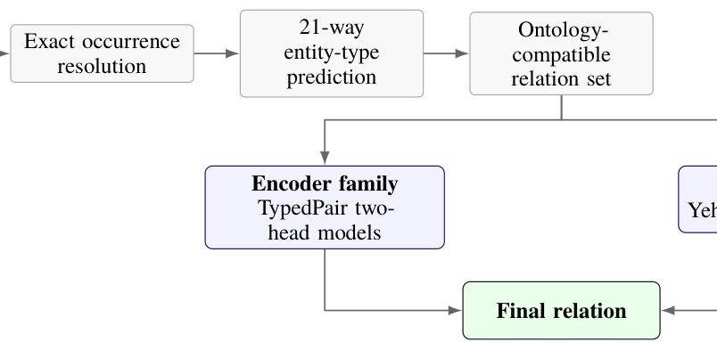

# U4RASD at KnowledgeGraphEval-2026: Ontology-Constrained Encoder and LLM Systems for Arabic Relation Extraction

- arXiv: https://arxiv.org/abs/2610.12742  (v1, submitted 2026-10-08, updated 2026-10-08)
- Authors: Ahmad Abbas, Hussein Mazeh, Chadi Abou Chakra, Aya Jouni, Mohammad Ballout, Fadi A. Zaraket
- Categories: cs.CL
- Collected: 2026-10-13 (KST)

## Abstract

This paper details our submission to KnowledgeGraphEval 2026 Subtask 2 on directed Arabic relation extraction. We explored encoder-based and large language model approaches for predicting one of 40 relations or no_relation from an Arabic sentence and a subject-object pair. Our encoder systems use typed entity markers and separate relation-existence and relation-classification heads, while our LLM systems fine-tune Yehia and Qwen3.5 with QLoRA and ontology-constrained prediction. Our best system, an ensemble of Yehia-RE, Qwen-RE, and TypedPair, achieved a micro-F1 score of 94.06 and ranked 1st in Subtask 2. Yehia-RE (full-vocabulary) achieved 92.98, while the best encoder and Qwen-RE achieved 92.69 and 91.94 respectively. Our results highlight the importance of constrained prediction and complementary modeling approaches for Arabic relation extraction.

## Figure 1

Figure 1: Shared relation-extraction pipeline and the two model families.
