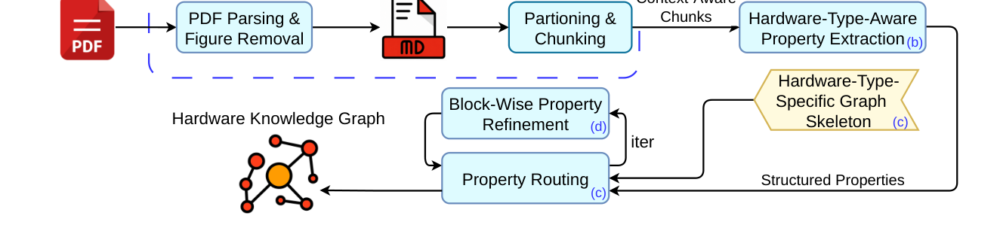

# Faithful and Complete LLM-Assisted Automated Construction of Hierarchical Hardware Knowledge Graphs

- arXiv: https://arxiv.org/abs/2610.12762  (v1, submitted 2026-10-08, updated 2026-10-08)
- Authors: Haotian Qiao, Robert P. Dick
- Categories: cs.AI
- Collected: 2026-10-13 (KST)

## Abstract

Hardware datasheets contain engineering specifications essential for component selection, system integration, and hardware compatibility verification. However, manual inspection is tedious and error-prone because datasheets are lengthy and heterogeneous, with dense information fragmented across tables, figures, and text. Although large language models (LLMs) can automate this process, naïve one-shot processing omits relevant specifications even when the document fits within the model's context window. We present an automated LLM-driven pipeline that transforms hardware datasheets into general-purpose hierarchical hardware knowledge graphs through chunk-based property extraction, hierarchical routing, and iterative refinement. The framework uses LLMs for information extraction and semantic reasoning while preserving source provenance and applying graph updates through validated instructions and deterministic local execution. This staged design reduces per-query context and maintains traceable intermediate representations. The resulting knowledge graphs provide semantically organized, source-grounded hardware properties for downstream retrieval and reasoning. We evaluate the framework on 20 hardware datasheets spanning diverse component types and document lengths. We assess property faithfulness and introduce inter-graph completeness to measure relative semantic coverage without exhaustive ground truth. Our framework achieves 98.8% property faithfulness compared with 76.1% for the one-shot baseline, while fully covering 83.6% of faithful baseline properties; in the reverse direction, the baseline fully covers only 10.5% of ours. These improvements provide more reliable and comprehensive engineering information for downstream hardware design and verification, reducing the risk of overlooked constraints and incorrect decisions.

## Figure 1

Fig. 1. Pipeline of our approach. The PDF is first preprocessed into table-preserved chunks ((a), Section III-A). Type-aware property extraction is then performed on these chunks ((b), Section III-B). Given an initial graph skeleton, the extracted properties are routed to construct the knowledge graph ((c), Section III-C). Finally, property deduplication, name-conflict resolution, and property rerouting are iteratively applied to refine the hardware knowledge graph until the maximum number of refinement iterations is reached ((d), Section III-D).
