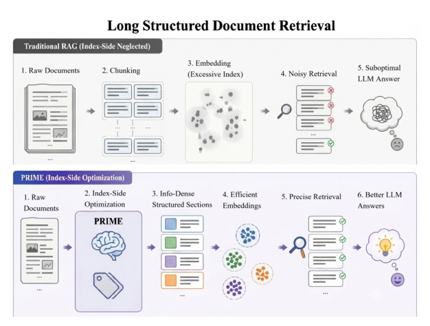

# PRIME: Pre-Retrieval Index Modeling Enhancement for Structured Document Retrieval-Real

- arXiv: https://arxiv.org/abs/2610.13296  (v1, submitted 2026-10-09, updated 2026-10-09)
- Authors: Cheuk Hei Chung, Li Liu
- Categories: cs.IR, cs.AI
- Collected: 2026-10-13 (KST)

## Abstract

High-precision retrieval over external knowledge bases is essential for LLM agents to operate effectively. However, existing Information Retrieval (IR) research primarily optimizes query-side retrievers (e.g., ColBERT, BGE) and generators (e.g., Self-RAG, GraphRAG), while reducing corpus-side representation to chunking. This leaves index-side quality an underexplored lever. We propose Pre-Retrieval Index Modeling & Enhancement (PRIME), an index-side optimization framework built on two complementary tracks: an LLM-driven Semantic Restructuring (SR) track that transforms long documents into structured, information-dense sections, and a deterministic Metadata Synthesis (MS) and Hierarchical Retrieval (HR) track that extracts semantic anchors and heading structure for coarse-to-fine section retrieval. Our evaluations show that deterministic metadata matches structure-aware chunking's retrieval quality while cutting embedding computation by 45.8 $\times$ and index vector count by 22.4 $\times$. On top of these gains, Semantic Restructuring (SR) further improves Answer-F1 by 13.7% in full deployment, with characterized quality-fidelity-cost trade-offs. Across QASPER, BRIGHT, and NFCorpus, we further characterize three qualitative regimes that determine whether index-side optimization helps or degrades retrieval, while showing that these index-side effects are neutralized under a strong reranker.

## Figure 1

Figure 1: Overview of Index-Side Optimization. PRIME op- erates on the corpus representation prior to indexing, com- plementing existing query-side and generator-side methods without modifying the retriever.
