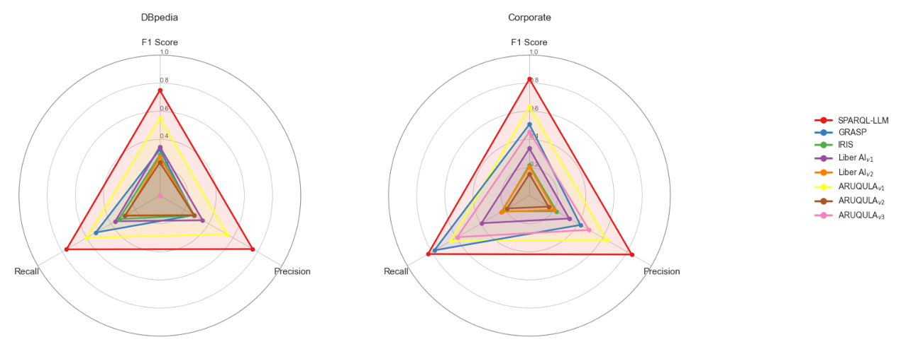

# SPARQL-LLM in the TEXT2SPARQL 2026 Challenge

- arXiv: https://arxiv.org/abs/2610.13648  (v1, submitted 2026-10-09, updated 2026-10-09)
- Authors: Panayiotis Smeros, Vincent Emonet, Ruijie Wang, Ana-Claudia Sima, Tarcisio Mendes de Farias
- Categories: cs.IR
- Collected: 2026-10-13 (KST)

## Abstract

Querying distributed data represented as Knowledge Graphs (KGs) via SPARQL remains a difficult task, requiring fluency in query syntax, endpoint specifications, and schema details. Knowledge Graph Question Answering (KGQA) systems address this by automatically translating natural language into SPARQL, and recent advances in Large Language Models (LLMs) have made this translation increasingly feasible. In this paper, we describe SPARQL-LLM, our open-source KGQA system, in the context of the TEXT2SPARQL 2026 challenge. In this challenge, SPARQL-LLM ranks first overall among eight competing approaches across all datasets, achieving up to 59% higher accuracy than the second-best approach and supporting multilingual question answering in English, German, and Spanish. SPARQL-LLM is publicly released at https://github.com/sib-swiss/sparql-llm and deployed in production over decentralized bioinformatics KGs at https://www.expasy.org/chat.

## Figure 1

Figure 1: Visualization of the overall results of the experiments produced by T2S-Metrics [15]. As we observe, SPARQL-LLM ranks first for both DBpedia and Corporate, with significant margin from the second best system.
