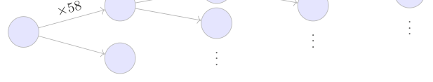

# Verifiable Retrieval for Legal Reasoning through Structure-driven Knowledge Graph

- arXiv: https://arxiv.org/abs/2610.13695  (v1, submitted 2026-10-09, updated 2026-10-09)
- Authors: Ibrahim Siddig, Sviatoslav Tugeev, Munir Georges
- Categories: cs.CL
- Collected: 2026-10-13 (KST)

## Abstract

Any automation within reliability-critical contexts such as medicine or law has to be transparent and verifiable. Despite their advantages, current LLM-based systems do not meet these requirements due to their inherent black-box nature. Retrieval Augmented Generation (RAG) attempts to ground the generative process in the relevant interpretable documents, thereby reducing the risk of AI 'hallucinations' and potentially enabling verification of the initial generation context. However, as the number and size of potential sources increases, naive retrieval approaches tend to perform worse, ignoring critical context elements. In this paper we aim to tackle this problem in the context of German Legal Code. Using structure-driven parsing to create a Knowledge Graph (KG) for the source document navigation and retrieval, we compare several KG-informed chunking and retrieval strategies and evaluate their effect on the accuracy of retrieved citations.

## Figure 1

Figure 1: The Statute knowledge graph hierarchy includes 58 federal codes, 168,469 nodes, and 240,507 edges. Column headers display each level’s name and total node count, noting that not all Sätze contain a Nummer or Buchstabe. Edge labels provide the average number of child nodes per branching parent at that level. Cross-reference edges marked cites_*, drawn in blue. Citations originate at a Satz node since they are tagged in sentence text and target a Satz (15,030), Nummer (6,805) or Buchstabe (418) node within the same code. The final graph is a forest of 58 disjoint code graphs, connected to the empty parent root node.
