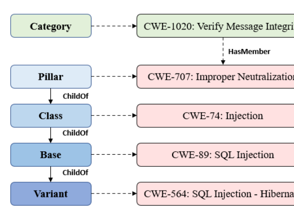

# SEEK: Agentic Knowledge Graph Retrieval for Secure Code Generation

- arXiv: https://arxiv.org/abs/2610.14968  (v1, submitted 2026-10-10, updated 2026-10-10)
- Authors: Varun Gadey, Markus Tohn, Lichao Wu, Ahmad-Reza Sadeghi, Alexandra Dmitrienko
- Categories: cs.CR, cs.LG
- Collected: 2026-10-15 (KST)

## Abstract

Large Language Models (LLMs) can generate functionally correct code while introducing exploitable security weaknesses, particularly when developers specify functionality without explicit security requirements. Recent state-of-the-art approaches mitigate this problem using external security knowledge, but largely rely on flat similarity-based retrieval over independent artifacts, making it difficult to infer the relevant vulnerability space and retrieve targeted knowledge when direct matches are unavailable. We propose SEEK, an agentic Graph RAG framework for secure code generation that constructs a security knowledge graph using the Common Weakness Enumeration (CWE) taxonomy as its structural backbone and injects it with curated real-world CVE vulnerability-fix instances. At inference time, a Planner Agent predicts potential CWE weaknesses associated with the developer query, which guide Graph Scoping to restrict retrieval to relevant regions of the CWE taxonomy before deterministic multi-faceted candidate ranking. A Selection Agent subsequently validates the predicted weaknesses and retrieved candidates prior to code generation. Across five open-source LLMs, we evaluate SEEK in an out-of-distribution setting on CodeGuard+ and CyberSecEval, spanning C, C++, and Python. SEEK achieves the highest SecurePass@1 of 77.45% on CodeGuard+ and the highest aggregate ICD pass rate of 79.45% on CyberSecEval, surpassing prior approaches. Moreover, SEEK achieves 85.2% SecurePass@1 across 13 unseen CWE types with no directly linked vulnerability-fix instances, demonstrating strong generalizability, while maintaining acceptable inference latency costs.

## Figure 1

Figure 1: Abstraction levels in the CWE taxonomy.
