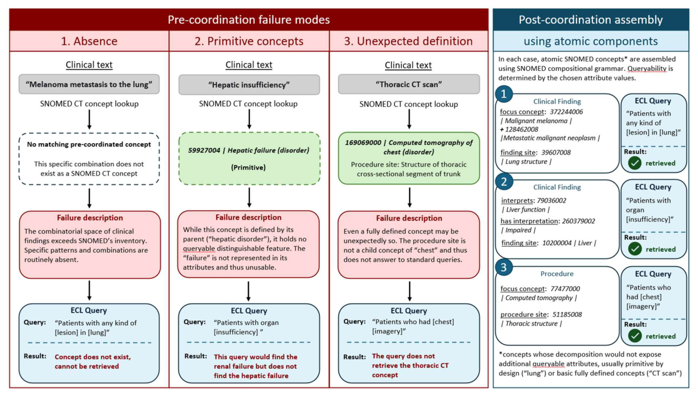

# Ontology-Based Post-Coordinated Expression Assembly: from Clinical Narrative to Queryable Knowledge Graphs

- arXiv: https://arxiv.org/abs/2610.16474  (v1, submitted 2026-10-12, updated 2026-10-12)
- Authors: Johann Pignat, Christophe Gaudet-Blavignac, Julien Ehrsam, Jean-Philippe Goldman, Cyrille Duret, Phil Cheng, Mina Bjelogrlic, Michel Cuendet, Christian Lovis, Olivier Michielin
- Categories: cs.CL
- Collected: 2026-10-15 (KST)

## Abstract

Clinical oncology documentation records decisive information in free text, where it remains readable but not retrievable at scale, leaving cohort identification dependent on incomplete diagnostic codes or manual review. The current standard, coding individual terms, captures what a document mentions, not what it asserts: meaning lies in how those terms relate to one another. We present a method for deriving queryable knowledge graphs from clinical narratives, conforming to the Extended Grammar of SNOMED CT across multiple ontologies. The method specifies how entities should be annotated and related. It defines five relation classes, each bound to a construction rule that assembles the entities and relations into post-coordinated expressions. A deterministic implementation, UNIGRAPHE, applies those rules to construct knowledge graphs from annotated text. Applied to expert-annotated real-world oncology documentation, UNIGRAPHE reconstructed 5,299 annotations into 2,196 post-coordinated expressions and shows that relation structure is the missing piece to make clinical narrative formally queryable.

## Figure 1

Figure 1: Three independent failure modes of pre-coordinated SNOMED CT concept mapping, and their resolution by post- coordinated assembly
