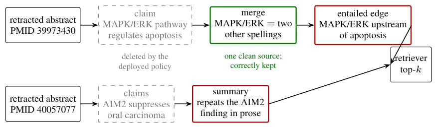

# Keep Your Receipts: Trustworthy Cleanup of Agent-Built Knowledge Graphs

- arXiv: https://arxiv.org/abs/2610.17719  (v1, submitted 2026-10-13, updated 2026-10-13)
- Authors: Vishisht Choudhary
- Categories: cs.AI
- Collected: 2026-10-15 (KST)

## Abstract

Agents build knowledge graphs as memory, and building them has become easy. Maintaining them has not. When a source is retracted, overruled, or erased, everything built on top of it (entity merges, entailed edges, community summaries) must be re-examined, and the maintainer must choose between deleting too much and too little. Deployed pipelines delete only the directly extracted facts: on our corpus that reduces contaminated queries from 32.2% to 28.0% under a real retraction and changes nothing under predicate revocation. Rebuilding is no repair for a constructor that samples: two builds of the same 300-document corpus differ in 29,475 artifacts, five times the 6,248 that removing the 61 retracted documents changes. PolyGraph instead asks the constructor for receipts: for every artifact, alternative bundles of source evidence, each claimed sufficient on its own, emitted in the call that creates it. Cleanup is then set arithmetic over the receipts, with no model calls. Because receipts are the model's own self-report, a re-derivation audit checks them by deleting the cited evidence and testing whether the constructor still produces the artifact. The audit finds that a receipt is trustworthy when it is shaped like the claim it backs. Merge receipts, each backing one narrow claim, agree with re-derivation 68% and 85% of the time. Summary receipts, elicited per sentence but stored as one flat list for the whole text, are wrong about two thirds of the time, almost always by keeping dead content. One receipt per sentence instead is 100% and 88% faithful and lets cleanup keep 33 of 35 touched summaries. The result holds under a second oracle model, a claim-blind prompt, ten further deletions, a second domain and a second constructor. Distrusting the summary layer cuts contaminated queries to 0.4% and 0.8% at 99.8 to 100% of the recall a perfect maintainer would return.

## Figure 1

Figure 1: Two real chains from the corpus. Deployed deletion removes only the extracted claims (dashed). The entity merge keeps one evidence source from a paper that still stands, so it is correctly retained (green); five of five re-derivations agree. The entailed edge and the summary rest only on retracted evidence, mention no retracted paper, and keep reaching the retriever (red). Support labels delete the edge with one disjointness test. The summary’s label wrongly claims it still stands, the failure Section 6 measures; the layered policy of Section 6.4 removes it.
