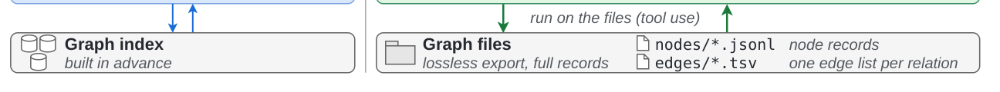

# Knowledge Graphs as Files: An Agent Harness Where Tool Creation and Tool Use Co-Evolve

- arXiv: https://arxiv.org/abs/2610.18616  (v1, submitted 2026-10-13, updated 2026-10-13)
- Authors: Yuyang Bai, Yu Wang, Yu Zhang
- Categories: cs.CL, cs.AI, cs.IR
- Collected: 2026-10-15 (KST)

## Abstract

Searching text-rich knowledge graphs requires following relations while examining textual evidence. Predefined graph interfaces constrain what evidence agents can access, even when they write code to combine tool calls or process retrieved subgraphs. We propose direct knowledge graph interaction (DKGI), a harness in which language model agents create graph access tools directly over complete node and edge files. The agent writes Python code to follow relations, combine node sets, and select textual evidence, interleaving execution with shell search and file inspection. This lets agents process large node sets in bulk while returning selected text for the model to assess. Execution feedback guides tool creation and revision, while the evolving tools determine what evidence the agent gathers next. On benchmark datasets spanning three domains, training-free DKGI exceeds the strongest published baseline by at least 6.7 Hit@1 points on every graph, even with a minimal harness. Controlled ablations show the benefits of multi-turn programming over shell-only access and predefined graph tools, while trajectories show agents revising code to extend searches or address errors. These findings highlight the value of allowing tool creation and tool use to co-evolve during graph search. Our code and data are available at https://github.com/leopoldwhite/DKGI.

## Figure 1

Figure 1: An example from the STaRK-MAG dataset (Wu et al., 2024b): “Papers on data quality enhancement algorithms affiliated with the University of the Balearic Islands”. (a) A neighbors call can only return 20 (out of 66) researchers affiliated with the university. The agent never encounters the gold paper in this run. (b) In our DKGI, tool creation and tool use co-evolve: execution feedback guides how the agent revises and extends its code, and the revised code gathers further evidence, ultimately isolating the gold paper. Bracketed numbers denote call indices.
