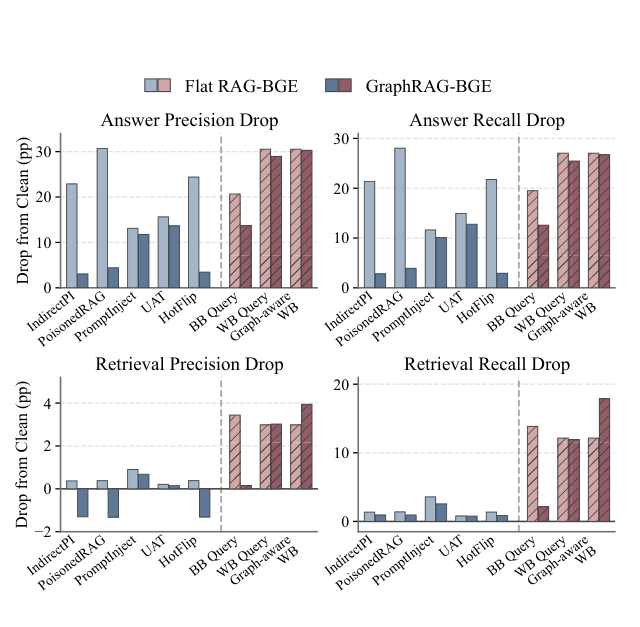

# GraphRAG-LTM: A Layered Threat Modeling Framework for Attacks on Graph Retrieval-Augmented Generation

- arXiv: https://arxiv.org/abs/2610.19549  (v1, submitted 2026-10-14, updated 2026-10-14)
- Authors: Yining Tang, Junyu Zhang, Haomiao Qiu, Yongchao Liu, Jiajun Zheng, Zhao Wang, Ziyue Qiao, Chao Wu
- Categories: cs.CL
- Collected: 2026-10-16 (KST)

## Abstract

Graph retrieval-augmented generation (GraphRAG) uses document-derived knowledge graphs to assemble evidence for large language model (LLM) answers. Its security depends on both the seed chunks retrieved for a query and the graph evidence assembled from them, yet attacks on this evidence path remain underexplored. We introduce GraphRAG-LTM, a Layered Threat Modeling framework that tests three nested levels of attacker access. BB Query uses ranking feedback to make query edits under a semantic-similarity constraint and demote relevant seed chunks. WB Query uses retriever gradients for the same objective. Graph-aware WB keeps the white-box adversarial query and deletes bridge triplets from the query-specific evidence graph, disrupting multi-hop evidence propagation through localized graph edits. Across datasets, retrievers, and LLM backbones, rank feedback alone reduces answer quality, gradient access strengthens query attacks, and bridge-triplet deletion further impairs supporting-fact retrieval. Further analyses show how seed retrieval and graph evidence jointly contribute to these failures.

## Figure 1

Figure 1: Answer and supporting-fact retrieval preci- sion and recall drops (percentage points from Clean) on HotpotQA-Distractor with BGE and LLaMA3-8B. Blue bars show prior baselines; red hatched bars show our BB Query, WB Query, and Graph-aware WB at- tacks. Lighter and darker shades denote Flat RAG and GraphRAG, respectively. Several baselines cause sub- stantially larger drops in answer precision and recall on Flat RAG than on GraphRAG, whereas our attacks remain effective on GraphRAG.
