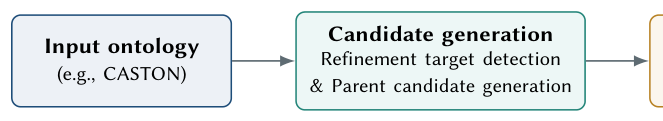

# Ontology Refinement with Embeddings and LLMs: A Case Study on CASTON

- arXiv: https://arxiv.org/abs/2610.21466  (v1, submitted 2026-10-15, updated 2026-10-15)
- Authors: Hui Yang, Ziyu Li, Xuan Liu, Anders Jarfors, He Tan, Jiaoyan Chen
- Categories: cs.AI
- Collected: 2026-10-19 (KST)

## Abstract

Ontologies are widely used to represent and organize complex knowledge in domains such as biomedicine and healthcare. However, constructing reliable ontologies remains challenging, as class hierarchies, whether manually or automatically constructed, may contain subtle subsumption errors that require careful refinement. We study this problem in CASTON, a casting-domain ontology, and present a lightweight but scalable refinement workflow that combines a fine-tuned ontology embedding model with Large Language Models (LLMs). The embedding model is used to extract a limited number of candidate axioms for refinement together with possible replacement candidates, and an LLM then returns repair suggestions. In a small expert evaluation, the default configuration using a CASTON-fine-tuned OnT embedding model and Qwen3-8B produced reliable high-confidence repairs: all six high-confidence replacements were accepted by both domain experts. The implementation is available at https://github.com/HuiYang1997/OntRefine.

## Figure 1

Figure 1: Overview of the ontology-refinement workflow.
