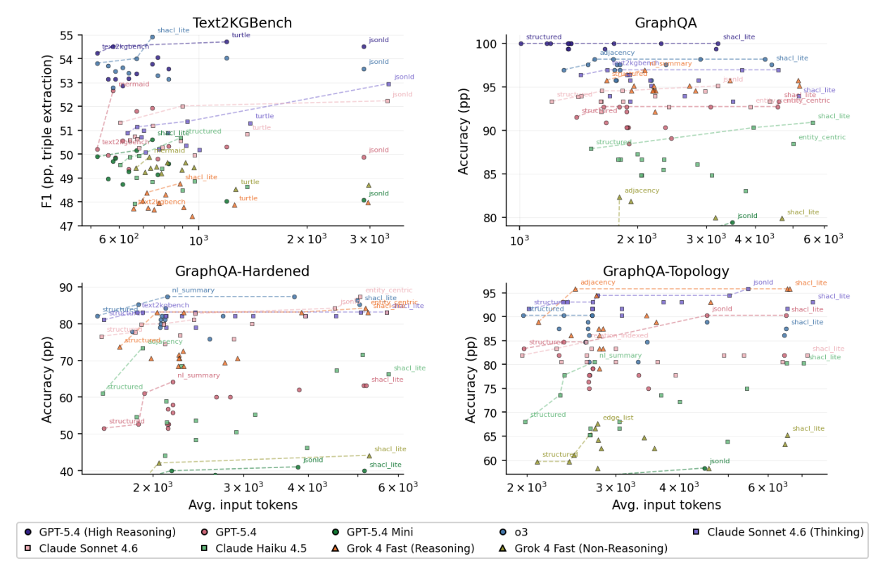

# Graph Serializations for Reasoning LLMs: A Study Across Knowledge Extraction and Structural Reasoning

- arXiv: https://arxiv.org/abs/2610.22734  (v1, submitted 2026-10-15, updated 2026-10-15)
- Authors: Julien Yu, Mihaela Bornea, Avirup Sil, Katrin Kirchhoff
- Categories: cs.AI
- Collected: 2026-10-20 (KST)

## Abstract

The way a knowledge graph is serialized as text for inclusion into LLM context can substantially affect downstream LLM performance, with prior work reporting tens of percentage points variations across formats. However, existing studies consider only a limited set of representations and predate frontier reasoning models, which now offer stronger reasoning, instruction-following, and long-context capabilities. We evaluate 15 graph representation formats across nine frontier LLM configurations on ontology-based knowledge extraction and structural graph reasoning tasks. While knowledge extraction is relatively insensitive to different serialization formats, the choice of the optimal format for structural reasoning tasks significantly affects accuracy. We demonstrate that the optimal representation choice depends on model, query, and task and propose to approach graph serialization as a dynamic orchestration decision.

## Figure 1

Figure 1: Score vs. input-token cost across the four benchmarks. Per-model Pareto fronts dashed.
