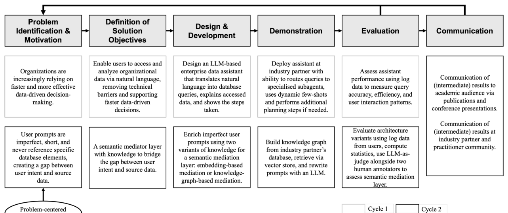

# Designing for Imperfect Prompts: A Simulation-Based Evaluation of an LLM-Based Enterprise Data Assistant Using Knowledge Graphs

- arXiv: https://arxiv.org/abs/2610.23304  (v1, submitted 2026-10-16, updated 2026-10-16)
- Authors: Niklas Wagner, Alexander Mädche
- Categories: cs.HC, cs.AI, cs.DB
- Collected: 2026-10-20 (KST)

## Abstract

Enterprise data assistants using large language models (LLMs) promise democratized data access in organizations. Yet in our real-world deployment within the CFO unit's data lake at an industry partner, we observed that business users frequently pose imperfect prompts that include domain-specific vocabulary and lack schema references or structural information. This Design Science Research study examines automatic resolution using a semantic mediation layer. We design and evaluate two design variants: schema-based mediation via semantic similarity, and knowledge graph-based mediation leveraging an automatically constructed knowledge graph from the data lake. Our simulation-based evaluation using real-world data, supported by LLM-as-a-Judge assessments and human validation, shows that knowledge graph-based mediation outperforms the schema-based approach in Precision, Recall, F1, and preserving user intent. We propose a design principle for knowledge graph-based mediation, demonstrating that structured knowledge representation bridges user intent and database structure and guides the design of enterprise data assistants across skill levels.

## Figure 1

Figure 1. DSR Framework.
