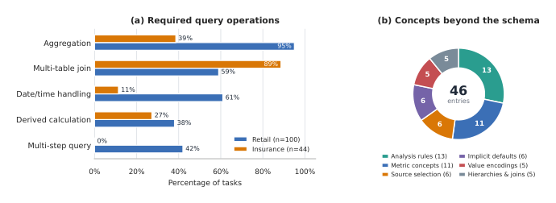

# AgentOnto: Ontology-Guided LLM Agents for Enterprise Data Analytics

- arXiv: https://arxiv.org/abs/2610.23317  (v1, submitted 2026-10-16, updated 2026-10-16)
- Authors: Dayan Pan, Bincheng Zuo, Xiaojian Wang, Daogang Zhang, Jingyuan Wang
- Categories: cs.AI, cs.DB
- Collected: 2026-10-20 (KST)

## Abstract

Enterprise data analysis requires agents to connect analytical requests with knowledge distributed across databases, business documents, and existing example tasks. Without an explicit representation of this knowledge, an agent may produce incorrect analytical results and cannot reliably incorporate feedback. We present AgentOnto, an ontology-guided LLM agent for enterprise data analytics. AgentOnto organizes heterogeneous enterprise knowledge into an ontology that directly guides analysis and incorporates confirmed feedback. Iterative Ontology Preparation further improves the ontology through self-generated analysis tasks. We evaluate AgentOnto on two public data sources. AgentOnto substantially outperforms representative methods, while module-level evaluations confirm the effectiveness of ontology construction, analysis, and updating. A real-world deployment further demonstrates its practical value in enterprise analytics. These results demonstrate that explicitly constructing, using, and updating enterprise knowledge supports reliable and adaptable data analysis.

## Figure 1

Figure 1: Analytical operations and business concepts in two public workloads. (a) Share of tasks requiring different ana- lytical operations across the retail and insurance workloads. (b) Distribution of business concepts required by the retail workload but not captured by its database schema.
