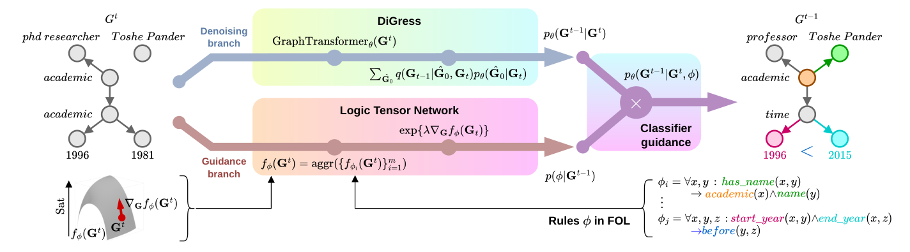

# Logic-Guided Graph Denoising Diffusion Models

- arXiv: https://arxiv.org/abs/2610.23766  (v1, submitted 2026-10-16, updated 2026-10-16)
- Authors: Samuel Cognolato, Luciano Serafini, Alessandro Sperduti, Andrea Cavallaro
- Categories: cs.LG
- Collected: 2026-10-20 (KST)

## Abstract

Graph diffusion models are competitive approaches for generating complex graph-structured data. However, when such distributions have strict structural constraints, diffusion models may fail to capture them exactly, resulting in the generation of invalid graphs. In this paper, we propose a method for grounding graph diffusion models in domain-specific knowledge via First Order Logic (FOL), leveraging its expressive and interpretable formalism to impose structural constraints on the generative process. We incorporate domain knowledge using classifier guidance, a technique that conditions the diffusion model's distribution on external variables to exert control over the sampled data. During the generative process, classifier guidance steers the denoising trajectory to optimize an objective function, which we define as a fuzzy and differentiable relaxation of the logical rules. Our methodology requires only the specification of constraints in FOL, whose satisfaction is encouraged at inference time to guide a pre-trained generative model. We evaluate our approach by comparing the unconditional generation of knowledge graphs with our logic-guided framework, which incorporates domain ontologies as structural constraints during inference. This approach significantly increases the proportion of generated graphs that satisfy the ontological constraints.

## Figure 1

Figure 1: Our LTN-guidance comprises two branches at each denoising step: (top) the pretrained DiGress model computes the denoising probabilities pθ(Gt−1|Gt); (bottom) LTN interprets the given FOL rules ϕ as the differentiable function fϕ, over which the gradient on Gt is computed, producing an approximation of p(ϕ|Gt−1). Classifier guidance (right) combines the two with element-wise product, returning the conditional probabilities pθ(Gt−1|Gt, ϕ).
