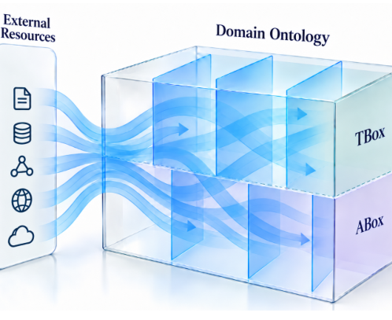

# Continuous Ontology Assurance through External Resources -- An Ontology Engineering Method with a Case Study in Software Language Engineering

- arXiv: https://arxiv.org/abs/2610.24322  (v1, submitted 2026-10-16, updated 2026-10-16)
- Authors: Ralf Lämmel
- Categories: cs.AI
- Collected: 2026-10-21 (KST)

## Abstract

Domain ontologies require review against knowledge recorded in evolving external resources. We propose COATER, a method that manages executable review components called arrows. Each arrow compares a scoped part of an ontology with a relevant resource and reports support or challenges to its axioms. Challenges may prompt proposals for completion, correction, or restructuring and become tasks for human or agent-assisted triage. Per-axiom coverage summarizes the assessments. We illustrate COATER with the FSL ontology in software language engineering (SLE): arrows review language coverage, language conceptualization, and software-engineering activities. An LLM-assisted linkage exercise increases compliance with a defined Wikipedia-linkage policy from 405 to 600 of 600 entities. A structured catalogue of SLE resources organizes review opportunities.

## Figure 1

Figure 1: Arrows in the COATER method.
