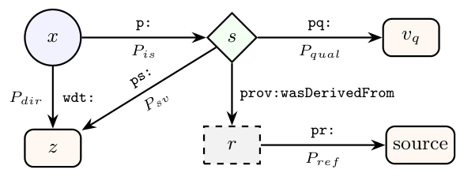

# SQuIREL: A Context-Relative Framework for Measuring Entity Richness in Wikidata

- arXiv: https://arxiv.org/abs/2610.24709  (v1, submitted 2026-10-17, updated 2026-10-17)
- Authors: Michelle Nwachukwu, Albert Meroño-Peñuela, Martim Brandão
- Categories: cs.AI, cs.DL
- Collected: 2026-10-21 (KST)

## Abstract

Wikidata is a large, heterogeneous knowledge graph and applying data quality metrics requires context-specific approaches. The "richness" quality metric is currently under-researched and typically restricted to the ontology level, which fails to capture entity-specific structural depth. To address this gap, we introduce SQuIREL, a method that measures richness directly at the entity level using six dimensions: Semantic Specificity, Qualifier Density, Internal Connectivity, Reference Provenance, External Network Connectivity, and Linguistic Accessibility. These dimensions are kept disaggregated to preserve actionability for targeted editorial intervention. We apply this metric to two case studies of oil paintings (Brazilian vs. French) and writers (grouped by citizenship and gender) to demonstrate how it surfaces representational inequalities that may indicate systemic bias. Our metric successfully distinguishes between highly tailored and basic entity profiles, revealing nuances that raw counts and existing aggregate scores obscure. Specifically, it identifies structural imbalances, such as 48% of Brazilian paintings clustering as low-richness stubs against 0% in the French cohort, as well as intersectional patterns, including contrasting gender gaps between UK and Nigerian writers.

## Figure 1

Fig. 1. How Wikidata models claims. The same fact can be expressed as a direct triple (x, p, z) with p ∈Pdir, or through a statement node s ∈SG which additionally supports qualifiers and references. Edges are labelled with their RDF namespace and corresponding property subset.
