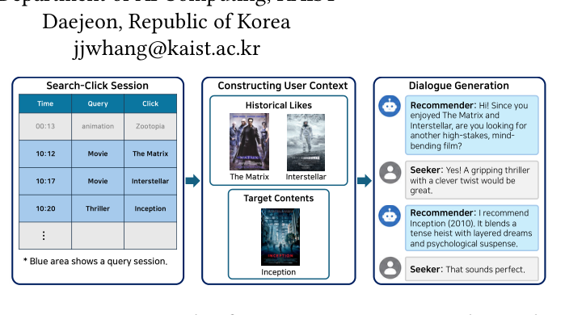

# Dialogue Generation for Conversational Recommendation Using User Search Interactions and Knowledge Graphs

- arXiv: https://arxiv.org/abs/2610.25182  (v1, submitted 2026-10-18, updated 2026-10-18)
- Authors: Minsung Hwang, Donggyu Yoon, Gowoon Hwang, Kwanghee Jang, Joyce Jiyoung Whang
- Categories: cs.AI, cs.CL, cs.LG
- Collected: 2026-10-21 (KST)

## Abstract

Large-scale conversational recommendation datasets typically require manual dialogue construction or annotation. We propose SearCl, which automatically generates conversational recommendation dialogues grounded in user search and click behaviors. SearCl segments user interactions into query sessions and derives each recommendation target from content selected after a search query. A configurable probabilistic state machine controls the dialogue flow, while two LLM agents acting as the seeker and recommender generate utterances according to turn-level constraints. To support recommendation, the recommender is provided with knowledge graphs constructed from metadata about the content items used in each dialogue, capturing their attributes and relationships. Using SearCl, we generate 3,538 dialogues from content search and click interaction data, covering 1,731 unique target items. Under an LLM-as-a-judge protocol, the resulting dialogues achieve higher quality scores than dialogues from existing benchmarks. These results demonstrate that SearCl enables controllable and knowledge-grounded dataset construction without human annotations.

## Figure 1

Figure 1: An example of generating a recommendation di- alogue from search-click interactions. The interactions are converted into a user profile and a recommendation target, which are then used to construct the dialogue.
