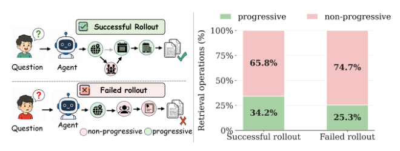

# Outcome-Anchored Credit Reallocation for Agentic Knowledge Graph Question Answering

- arXiv: https://arxiv.org/abs/2610.25384  (v1, submitted 2026-10-18, updated 2026-10-18)
- Authors: Mingyuan Li, Yucheng Li, Xiaxia Wang, Gong Cheng
- Categories: cs.AI, cs.CL, cs.LG
- Collected: 2026-10-21 (KST)

## Abstract

Agentic knowledge graph question answering (KGQA) requires large language models (LLMs) to solve complex questions through multi-turn interactions with a knowledge graph (KG). Outcome-supervised reinforcement learning derives verifiable outcome rewards from final answers but uniformly assigns each rollout's outcome-level advantage to all policy-generated tokens, creating a trajectory-to-operation mismatch since KG operations within a rollout can have varying effects on the search process and final answer. To address this, we propose Outcome-Anchored Credit Reallocation (OACR), which employs a training-only KG-state outcome model to estimate outcome-reward changes between adjacent KG search states and converts them into operation credit, from which token-wise weights are derived. These multiplicative weights reallocate token-level update magnitudes while preserving the sign of the outcome-level advantage at every generated token. Across three benchmarks, OACR achieves stronger overall performance than existing KGQA methods while using fewer inference-time LLM calls and tokens.

## Figure 1

Figure 1: Trajectory-to-operation mismatch under outcome-supervised RL. Left: Successful rollouts may contain non-progressive entity-return operations, while failed rollouts may contain progressive ones. Right: Dis- tribution of progressive and non-progressive entity-return operations across successful and failed rollouts, based on 5,000 such operations generated by Qwen2.5-3B on CWQ.
