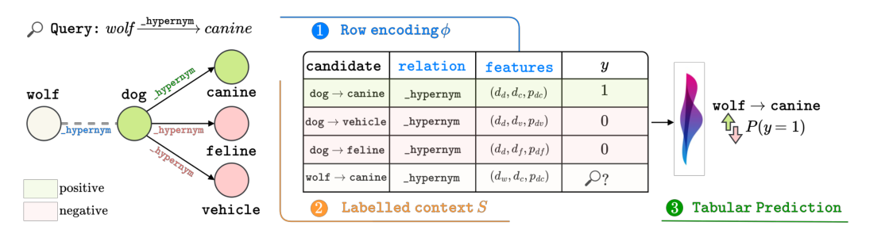

# Graph-to-Table Interfaces Control Relational Generalisation

- arXiv: https://arxiv.org/abs/2610.25993  (v1, submitted 2026-10-19, updated 2026-10-19)
- Authors: Alessandro Cagiano, Lorenzo Molfetta, Gianluca Moro, Matteo Zignani, Pasquale Minervini
- Categories: cs.LG
- Collected: 2026-10-21 (KST)

## Abstract

Graph-to-table systems combine three design choices: an encoder that maps relational evidence to feature rows, a context constructor that selects labelled examples, and a tabular decoder. We investigate whether these components can be evaluated independently through matched comparisons that change one component while holding the rest of the pipeline and the evaluation constant. Across logistic regression, CATBOOST, and TABPFN-3 on CLUTRR, 57 GraphLog worlds, and 57 knowledge graphs, we show that conclusions about one component can change when the others change. On CLUTRR, absolute positional encodings maintain all distinctions among the evaluated queries and fit the short-path setting nearly perfectly; yet, they generalise worse than relation-count features because the supported prefix acts as a shortcut that breaks down on longer paths. On GraphLog, encoder preference depends on the decoder, while the relation-count representation degrades as CatBoost tree depth increases. Across different knowledge graphs, adding the frozen ULTRA score to local features is consistently useful, whereas adding local features to the score has a smaller and less stable effect. A pointwise TABPFN-3 readout using the full encoder underperforms native ULTRA on 48 of 57 datasets. These results show that encoder assessment depends jointly on context and decoder, while panel-level conclusions can also depend on evaluation and aggregation protocols.

## Figure 1

Figure 1: Graph-to-table prediction pipeline. Given a relational query and its surrounding graph, the encoder ϕ constructs a feature row, the context constructor S assembles labelled examples from the target graph, and the tabular decoder D produces prediction scores for the held-out query.
