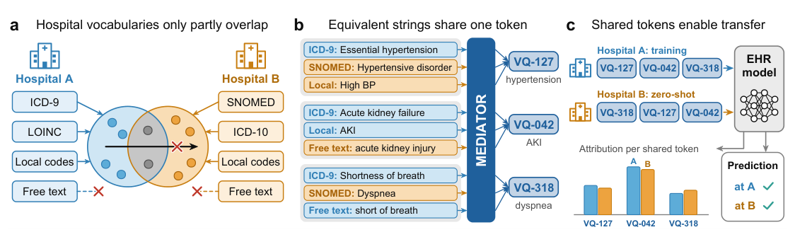

# Discrete Neural Interlingua for Ontology-Agnostic EHR Modeling

- arXiv: https://arxiv.org/abs/2610.27047  (v1, submitted 2026-10-19, updated 2026-10-19)
- Authors: Tong Ding, Caiwei Tian, Dongmin Bang, Ming Y. Lu, Sophia J. Wagner, Andrew Zhang, Rowland Pettit, Long Phi Le, Faisal Mahmood
- Categories: cs.CL, cs.AI, cs.LG
- Collected: 2026-10-22 (KST)

## Abstract

EHR foundation models promise scalable clinical prediction across health systems, yet their deployment is constrained by a tokenization bottleneck. The same clinical concept can appear as different ontology codes, local identifiers, synonyms, or free-text descriptions, which standard EHR tokenizers treat as unrelated symbols. A model trained on MIMIC-III with a closed-vocabulary tokenizer can use only 13% of eICU events. We introduce MEDIATOR, a discrete ontology-agnostic tokenizer that maps any clinical concept expressed as text into a shared vector-quantized codebook, turning EHR harmonization into open-vocabulary tokenization without manual mappings or a fixed vocabulary. Trained with synonym supervision and guided by enriched concept descriptions, code co-occurrence, and relation graphs, MEDIATOR collapses equivalent expressions while organizing distinct concepts in a medically meaningful discrete space. Used as the token interface of an EHR Transformer, MEDIATOR improves mean AUPRC over the strongest prior tokenizer by 4.0 points (8% relative) on 20 MIMIC-III tasks and by 8.6 points (29% relative) in zero-shot transfer to 14 eICU tasks, where it uses all events. The transfer gain combines coverage and representation, as MEDIATOR remains the best tokenizer under identical inputs (+1.0 and +1.9 points on operational and subcohort-mortality tasks). Same-encoder controls show that the text encoder drives in-domain accuracy, while the learned objectives of MEDIATOR drive transfer robustness and entity-linking quality. MEDIATOR also enables transferable attribution across hospitals.

## Figure 1

Figure 1: Motivation for MEDIATOR. a. The vocabularies of Hospital A (light blue) and Hospital B (orange) only partly overlap, so models trained at A fail on B-specific codes and drop free text. b.
