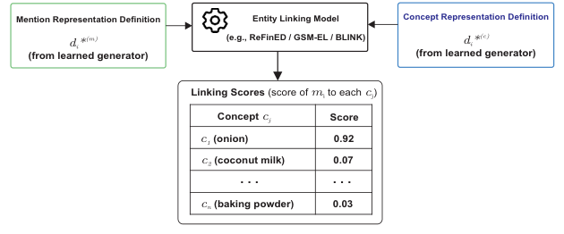

# SCODEL: Shared Canonical Ontology Definitions for Food Entity Linking and Ontology-Grounded Recipe Knowledge Graphs

- arXiv: https://arxiv.org/abs/2610.27637  (v1, submitted 2026-10-20, updated 2026-10-20)
- Authors: Nuhu Ibrahim, Rishi Ravikumar, Ayuba Dauda, Fuqi Xu, Robert Stevens, Riza Batista-Navarro
- Categories: cs.AI
- Collected: 2026-10-22 (KST)

## Abstract

Identifying recipe entities and linking them to ontology concepts is fundamental for semantic recipe understanding. However, food mentions in recipes are often ambiguous, context-dependent, and lexically diverse, making ontology entity linking (EL) challenging. We propose SCODEL, a streamlined, model-agnostic approach based on a central idea: contextual food mentions and ontology concepts that refer to the same entity should learn the same canonical ontology-oriented definition. SCODEL uses these shared definitions as a semantic normalisation layer, providing complementary semantic information to existing EL models without requiring a new linking architecture. We further introduce ReciLinkD, the first benchmark for contextual food ontology entity linking in recipes. Experiments show that SCODEL consistently improves three modular EL models (ReFinED, GSM-EL, and BLINK): SCODEL x BLINK achieves the highest Hit@1 on seen concepts (88.33%), while SCODEL x GSM-EL achieves the highest Hit@1 on unseen concepts (83.15%), outperforming the strongest large language model (LLM) based EL baseline in each setting. Experiments on a biomedical ontology benchmark further demonstrate that SCODEL generalises beyond the food domain. Finally, we use SCODEL to ground food mentions at scale and construct an ontology-grounded recipe knowledge graph, demonstrating its utility for ontology-aware recipe retrieval and corpus-level food analysis.

## Figure 1

Figure 1: Overview of the proposed SCODEL methodology.
