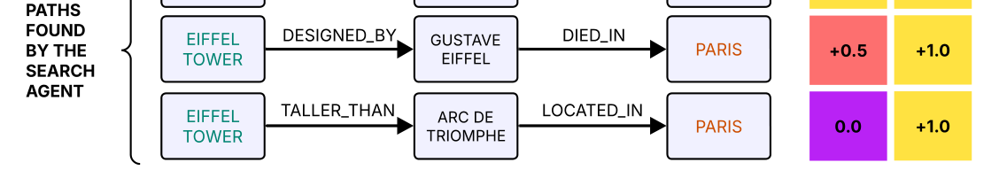

# RANGER: Retrieval Agent for Navigating Graphs with Semantic Evaluation Rewards

- arXiv: https://arxiv.org/abs/2610.28010  (v1, submitted 2026-10-20, updated 2026-10-20)
- Authors: Artem Mikhaylov, Pavel Konoplev, Nikolay Efanov, Artyom Sorokin, Evgeny Burnaev
- Categories: cs.LG
- Collected: 2026-10-22 (KST)

## Abstract

The integration of Large Language Models and Reinforcement Learning offers a promising direction for complex sequential decision-making tasks, such as multi-hop question answering over knowledge graphs. While LLMs provide strong semantic understanding and reasoning capabilities, they often struggle with precise, multi-step navigation in structured environments. Conversely, RL agents excel at learning navigation policies but are hindered by the difficulty of designing semantically meaningful reward functions. This paper introduces a novel hybrid approach in which an LLM serves as a mentor to an RL agent during training by providing dense, semantically informed reward signals. The RL agent, built on a Transformer-based policy and trained with Group Relative Policy Optimization, learns to navigate a knowledge graph to retrieve relevant information. The LLM evaluates the semantic relevance of the agent's traversed paths, generating reward signals that align the agent's behavior with the information needs expressed in a query. We integrate this Retrieval Agent for Navigating Graphs with Semantic Evaluation Rewards (RANGER) into a complete question-answering pipeline and evaluate it on the open question answering datasets. Experimental results show that the proposed approach outperforms both a baseline retrieval-augmented system with classical graph search and one using an RL agent trained with heuristic rewards, achieving a significant increase in NLP metrics and LLM-as-a-Judge scores. Our findings demonstrate that deep integration of LLMs into the RL training loop yields more effective and semantically aligned retrieval policies for complex reasoning tasks.

## Figure 1

FIGURE 1: Comparison of heuristic and LLM-based rewards for paths in knowledge graphs. In this example the question is formed from the triplet (eq = Eiffel Tower, rq = located_in, ea = Paris). Given (eq, rq), the agent must restore the initial triplet (direct rq transition is masked out in the KG). The procedural heuristic (H) assigns the same reward to every path that reaches ea, regardless of whether the intermediate triples provide evidence for the original question. In contrast, the LLM-based reward (LLM) evaluates whether the discovered path supports reconstructing the original triplet: paths that justify the triplet receive a high reward, while indirect or irrelevant paths receive lower rewards.
