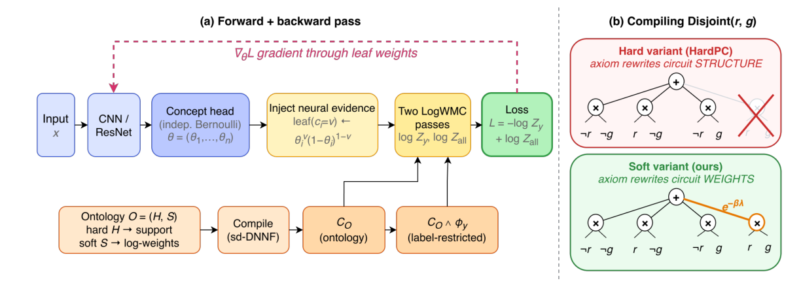

# Soft Ontology Priors over Latent Concept Posteriors for Weakly Supervised Neuro-Symbolic Learning

- arXiv: https://arxiv.org/abs/2610.30391  (v1, submitted 2026-10-21, updated 2026-10-21)
- Authors: Tengwei Song, Robert Hoehndorf
- Categories: cs.AI, cs.LG
- Collected: 2026-10-26 (KST)

## Abstract

Neuro-symbolic (NeSy) predictors that supervise only the task label suffer from reasoning shortcuts: distinct concept mappings achieve the same maximum likelihood, leaving the recovered concepts unidentifiable and unsafe for downstream reuse. We attack this failure by injecting a soft ontology prior over the latent concepts into the training objective and compiling it together with the task constraint into a smooth, decomposable probabilistic circuit. Under independent Bernoulli perception, the normalisers of the resulting structured concept posterior reduce to weighted model counts that are linear in the compiled circuit size, because the neural leaf weights fold into the circuit before evaluation. The soft compilation strategy places expert axioms in the circuit's weights rather than its support (task-structural axioms guaranteed by the data-generating process stay hard), so noisy expert axioms only redistribute prior mass and cannot empty the support. We characterise how the prior reweights label-restricted shortcut mass through differences in ontology violation energy, show that soft priors incur bounded log-density perturbations under bounded axiom noise, and prove that the hard-support counterpart can be made degenerate by a single corrupted axiom. We validate these predictions on an audited six-concept view of the real-world BDD-OIA driving benchmark and on controlled NeSy tasks.

## Figure 1

Figure 1: Method overview. (a) Forward + backward pass with leaf reweighting and two
