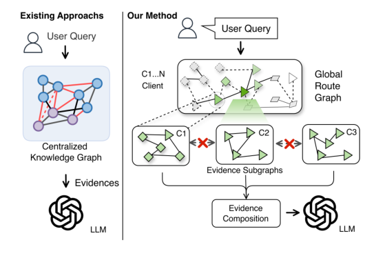

# Federated Graph Retrieval-Augmented Generation

- arXiv: https://arxiv.org/abs/2610.30728  (v1, submitted 2026-10-22, updated 2026-10-22)
- Authors: Xiaobao Wang, Renda Han, Zhiliang Xia, Meng Liu, Renxiang Guan, Di Jin
- Categories: cs.LG
- Collected: 2026-10-26 (KST)

## Abstract

Graph Retrieval-Augmented Generation (GraphRAG) leverages centralized knowledge graphs to enhance large language models with structured knowledge retrieval. However, real-world knowledge is inherently distributed across multiple organizations rather than being centrally accessible. Privacy constraints further prohibit sharing entire local knowledge graphs, preventing GraphRAG from effectively retrieving and utilizing distributed knowledge. To this end, we propose Federated GraphRAG (FedGRAG), a unified framework for distributed graph retrieval and knowledge-enhanced generation over multiple clients with knowledge graphs. Specifically, we address two fundamental challenges in federated GraphRAG. First, the absence of a global knowledge graph makes unified retrieval impossible. To address this, we develop a Federated Knowledge Routing mechanism that efficiently identifies relevant clients through lightweight knowledge indices without exposing local graph structures. Second, local graph memory cannot be shared directly because it contains sensitive entities and knowledge information. We therefore propose a controlled-disclosure evidence construction method. It extracts retrieved evidence subgraphs and converts them into an evidence abstract, enabling evidence conversion and reconstruction on the server. Extensive experiments demonstrate that Federated GraphRAG consistently outperforms existing baselines in both retrieval and downstream generation tasks, establishing a new paradigm for deploying GraphRAG in federated environments.

## Figure 1

Figure 1: Motivation of Federated GraphRAG. Existing GraphRAG relies on centralized graph memories, while directly extending Federated RAG fails to capture semantic relationships among distributed graph memories.
