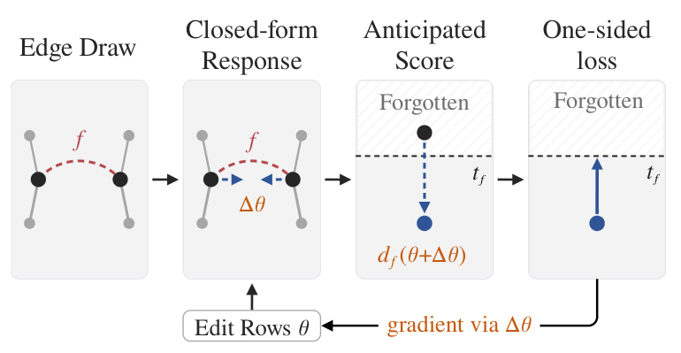

# When Forgotten Facts Return: Relearning-Aware Unlearning of Knowledge Graph Embeddings via Tangent Kernels

- arXiv: https://arxiv.org/abs/2610.31075  (v1, submitted 2026-10-22, updated 2026-10-22)
- Authors: Parnian Fazel, Mohammad M Maheri, Hamed Haddadi
- Categories: cs.LG
- Collected: 2026-10-26 (KST)

## Abstract

Approximate unlearning answers a deletion request on a knowledge-graph embedding by editing entity embeddings instead of retraining from scratch. These embeddings keep being updated as new facts arrive. Under this ordinary continued training, forgotten facts recover more than in the exact-unlearning baseline, a model retrained without them and given the same continued training. We trace this relearning to entity embeddings shared by forgotten and new facts. To our knowledge, this is the first study of relearning in knowledge-graph embeddings. Relearning-robust methods developed for deep networks do not account for the graph structure underlying this recovery. We propose Kernel-Anticipated Unlearning (KAU), which uses the tangent kernel to model how continued training changes forgotten facts' scores through these shared parameters. KAU expresses this first-order response in closed form and differentiates through it inside the forgetting loss. The objective steers edits toward directions that continued training reverses less. We compare KAU with state-of-the-art knowledge-graph unlearners and relearning-robust methods under identical continued training, measuring leakage beyond the exact-unlearning baseline. Across three backbones, KAU reduces the strongest knowledge-graph unlearner's leakage by 46-63% on FB15k-237 and 50-82% on CoDEx-L, at higher retained utility.

## Figure 1

Figure 1: KAU’s objective (Section 4). The loss acts on each forgotten fact f’s score after a closed-form response ∆θ to a drawn edge set, pushing it to a target tf. Its gradient flows through ∆θ to the edited rows θ.
