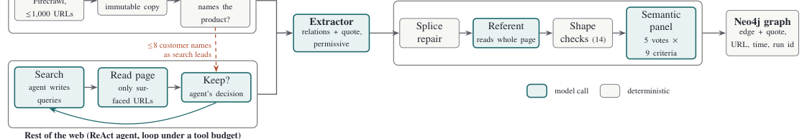

# Every Edge Needs a Quote: Building a Quote-Grounded Knowledge Graph of Healthcare Software Adoption with Language-Model Agents

- arXiv: https://arxiv.org/abs/2610.32781  (v1, submitted 2026-10-23, updated 2026-10-23)
- Authors: Juan Felipe Duran, Arthur Tobler, Martin Vallières
- Categories: cs.CL, cs.AI, cs.IR
- Collected: 2026-10-27 (KST)

## Abstract

Hospitals regularly buy software that clinicians and patients depend on. Because these purchases are costly, hard to reverse and can affect patient care, buyers look for evidence of which peer institutions already use a product and which systems it connects to. This evidence is public but scattered across vendor websites, press releases and third-party pages. Language-model agents can now collect it at low cost, but the correctness of the extracted claims is difficult to establish, and a wrongly listed customer can mislead buyers and misrepresent an organisation. We present a pipeline that builds a knowledge graph of customer and integration relations from the open web under one rule: every edge must be supported by a verbatim quote from its source page. Pages come from a deterministic crawl of each vendor's site and a budgeted ReAct agent that searches the rest of the web. A permissive extractor proposes relations with quotes, and a layered grounding stage decides which to keep, using a referent step that reads the whole page when a quote names only one side, deterministic checks, and a panel of five model calls voting on nine criteria. On 61 vendors, the pipeline reaches 0.94 precision and 0.71 recall against a page-level key covering the 6,428 candidate relations proposed by its extractor, whose verdicts were drafted by one model and re-checked with a second. Against the golden reference, the marketplace's own curated list, it scores lower, but 89% of the relations it keeps that the reference lacks are stated on a page. A confidence score built from the panel's votes keeps more correct relations than the fixed rule at the same precision, and reaches 0.90 precision at 0.90 recall. We also discuss how narrow, bounded model calls, string-matched evidence and voting address long-context degradation and run-to-run variance.

## Figure 1

Figure 1: The pipeline. Discovery finds pages in two halves: a deterministic sweep of the vendor’s own site, and a ReAct agent that searches everything else under a tool budget. Customer names confirmed on the vendor’s site become search leads for the agent. Both halves feed the same extractor and the same grounding stage, which run in the order shown. Only relations that survive every step are written, each with its quote and provenance.
