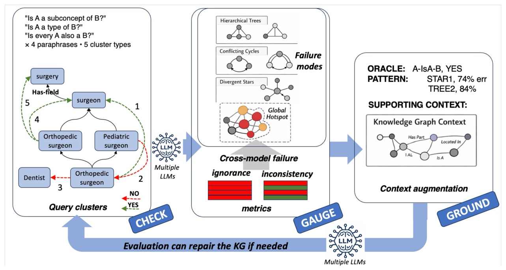

# Scoped Semantic Invariance as a Foundation for LLM Reliability

- arXiv: https://arxiv.org/abs/2610.33267  (v1, submitted 2026-10-23, updated 2026-10-23)
- Authors: Rosario Uceda-Sosa, Maria Chang, Karthikeyan Natesan Ramamurthy, Moninder Singh
- Categories: cs.AI
- Collected: 2026-10-28 (KST)

## Abstract

LLMs often answer semantically equivalent queries inconsistently, even when the underlying facts are known. We formalize consistency as semantic invariance over equivalence classes of queries and show that invariance under arbitrary meaning-preserving transformations is undecidable in general. This motivates scoped semantic invariance, where model behavior is evaluated relative to bounded semantic domains. We operationalize this framework using knowledge graphs (KGs), which act as explicit semantic control structures defining local semantic constraints and grounding contexts. Across the MITRE D3FEND ontology and eight Wikidata- derived domains, we show that inconsistencies are structured rather than random, concentrating in localized hotspot subgraphs organized around recurring TREE, STAR, and CYCLE patterns that remain stable across models and domains. We further show that selective graph grounding improves correctness and cross-model consistency, while indiscriminate grounding introduces regressions. A layered grounding strategy achieves the strongest monotonicity profile, preserving correct knowledge while reducing inconsistency. Finally, we show that hotspot structures discovered from simple consistency probes transfer to more realistic compositional reasoning tasks.

## Figure 1

Figure 1: Pipeline overview. CHECK establishes baseline consistency and accuracy. GAUGE identifies hotspot subgraphs and structural failure patterns. GROUND applies selective semantic grounding strategies.
