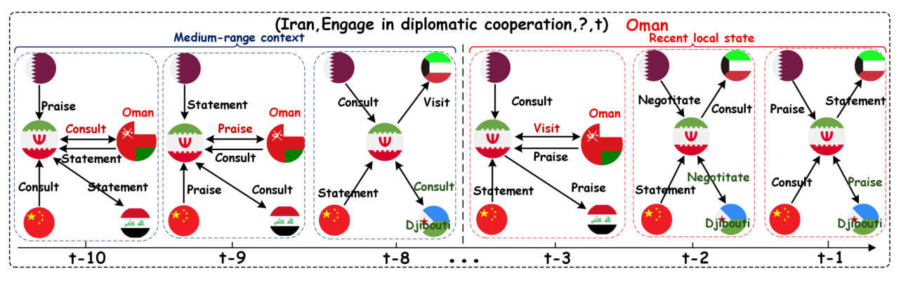

# DyHist: Query-Aware Historical Dynamics Modeling for Temporal Knowledge Graph Extrapolation

- arXiv: https://arxiv.org/abs/2610.33473  (v1, submitted 2026-10-24, updated 2026-10-24)
- Authors: Peiyuan Jiang, Yao Liu, Yubo Wen, Yanglei Gan, Lu Liu, Ruojie Zhang, Jiaye Yang, Yuewei Xue, Jiaya Deng, Xiaogu Guo, Qiao Liu
- Categories: cs.IR
- Collected: 2026-10-28 (KST)

## Abstract

Temporal Knowledge Graph (TKG) extrapolation aims to predict future facts from observed historical events. Existing methods usually achieve this goal by jointly modeling local historical evolution and long-range historical contexts. First, local evolution modeling often summarizes local history into an overall evolving representation, where query-relevant local deviations may not be sufficiently exploited as useful predictive features. Second, existing long-range history modeling often treats historical recurrence as a stable cue, while overlooking that its reliability may vary across relations and recent contexts. To address these issues, we propose DyHist, a query-aware historical dynamics modeling framework for TKG extrapolation. DyHist captures local dynamics by separating recent evidence from medium-range contexts and explicitly modeling their query-relevant deviations as predictive features. It further uses a relation-aware historical prior to calibrate candidate scores with time-decayed support, recent trends, and relation-specific strength, enabling recurrence signals to contribute differently across relations and recent contexts. Experiments on four benchmarks show that DyHist achieves the best MRR against recent baselines. Code is available at https://github.com/PANPANKK/DyHist.

## Figure 1

Figure 1: Illustration of local historical evidence for the query (Iran, Engage in diplomatic cooperation, ?, t). Red links denote Oman as medium-range contextual evidence, while green links denote Djibouti as more recent evidence near the query time.
