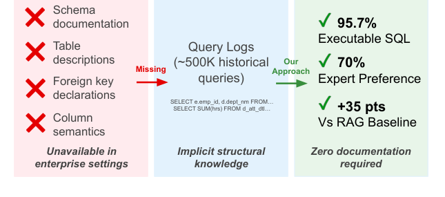

# Schema-Free Text-to-SQL: Learning Enterprise Database Structure from Query Logs

- arXiv: https://arxiv.org/abs/2610.33946  (v1, submitted 2026-10-24, updated 2026-10-24)
- Authors: Ömer Faruk Akgül, Nikhil Kapahi, Prajit Reddy Muppidi
- Categories: cs.CL
- Collected: 2026-10-28 (KST)

## Abstract

Text-to-SQL systems achieve remarkable accuracy on academic benchmarks, yet performance drops dramatically in enterprise deployments. This gap stems from a fundamental assumption: existing approaches require complete schema documentation, but enterprise databases typically lack comprehensive documentation, featuring cryptic naming and implicit relationships. We present the first text-to-SQL framework that operates without schema documentation, instead learning database structure from historical query logs. Query logs encode implicit structural knowledge: which tables are queried together, how they join, and what columns map to business concepts. We construct a knowledge graph from parsed query patterns and introduce entity-driven GraphRAG retrieval that grounds user questions in domain terminology rather than relying solely on embedding similarity. Validated on both an industrial deployment with expert evaluation and the Beaver benchmark, our approach substantially outperforms similarity-based retrieval methods, the dominant industry approach, in both executability and answer quality. On Beaver, we achieve 95.7% execution validity compared to 60.8% for embedding-based retrieval, with expert data engineers preferring our system 70% to 10% on internal deployment. Our work demonstrates that text-to-SQL can operate effectively in schema-ambiguous enterprise environments, enabling natural language database interfaces "in the wild".

## Figure 1

Figure 1: State-of-the-art text-to-SQL systems require complete schema documentation unavailable in enter- prise settings. Operating with only historical query logs, our approach achieves 95.7% execution validity and 70% expert preference over embedding-based retrieval.
