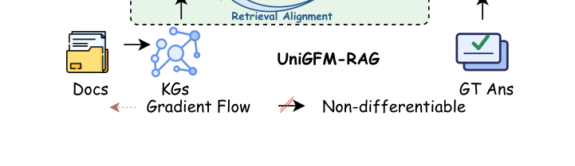

# UniGFM-RAG: Unify Graph Foundation Models and Large Language Models for End-to-End Retrieval and Reasoning

- arXiv: https://arxiv.org/abs/2610.34866  (v1, submitted 2026-10-26, updated 2026-10-26)
- Authors: Zicheng Zhao, Linhao Luo, Zongji Yu, Junnan Dong, Yanchao Tan, Shirui Pan, Chen Gong
- Categories: cs.AI
- Collected: 2026-10-28 (KST)

## Abstract

Large Language Models (LLMs) have shown remarkable capabilities across tasks, but they still struggle with complex reasoning that requires integrating scattered knowledge. Graph Retrieval-Augmented Generation (GraphRAG) addresses this challenge by organizing fragment knowledge as graphs, while recent Graph Foundation Models (GFMs) further improve GraphRAG with graph-native retrieval and reasoning capabilities. However, existing GraphRAG methods usually adopt decoupled retrieve-then-generate pipelines, which create objective misalignment between retrieval and reasoning, and training GFM retrievers typically depends on expensive human annotations. To address these limitations, we propose \ourmethod, a unified end-to-end GraphRAG framework that tightly couples a GFM retriever with an LLM generator. Given a query, the GFM retriever first reasons over the graph to score and retrieve relevant document nodes. These node embeddings are then passed through a fully differentiable graph bridge, which projects them into soft-weighted graph prefixes according to retrieval scores and combines them with raw document texts to form graph-augmented prompts. In this way, structural information is injected directly into LLM generation, while the final answer loss can be back-propagated through the bridge to jointly optimize retrieval and reasoning. To stabilize training and reduce reliance on costly annotations, we further introduce a semantic-guided distillation module that provides auxiliary supervision using pseudo-labels derived from query-document semantic similarities. Extensive experiments on three multi-hop QA datasets and three out-of-domain GraphRAG benchmarks show that \ourmethod consistently outperforms strong baseline methods and generalizes well, which demonstrates the effectiveness of end-to-end GraphRAG with tightly integrated GFM retrieval and LLM reasoning.

## Figure 1

Fig. 1: Comparison between the current two-stage GraphRAG and the proposed UniGFM-RAG. Existing GraphRAG meth- ods usually employ a decoupled retrieve-then-generate pipeline, which often results in objective misalignment. In contrast, UniGFM-RAG introduces a unified end-to-end GraphRAG framework that tightly couples a Graph Foundation Model (GFM) retriever with a Large Language Model (LLM) generator.
