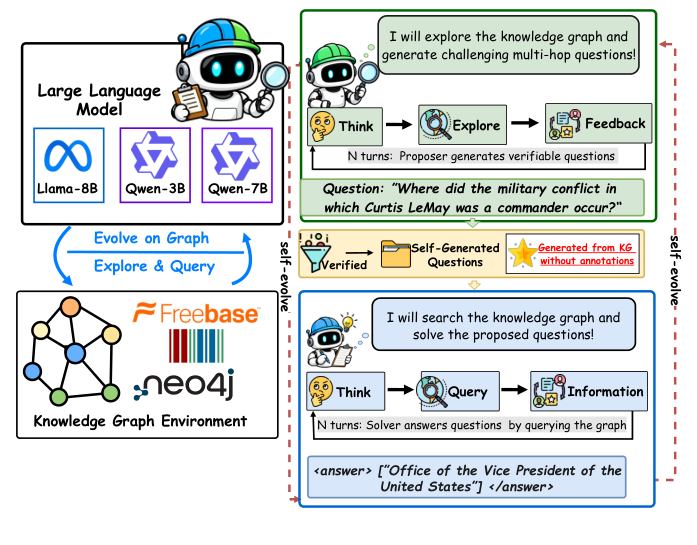

# Evolve on Graph: Self-Evolving Knowledge Graph Reasoning without Question Annotations

- arXiv: https://arxiv.org/abs/2610.35598  (v1, submitted 2026-10-26, updated 2026-10-26)
- Authors: Zongyuan Sun, Shuai Zhao, Ke Shu, Ziyue Zhu, Shangyang Wu, Yuanlin Lin, Tao Wang, Shiyue Li, Yingjun Du, Anh Tuan Luu, Haoran Luo
- Categories: cs.AI
- Collected: 2026-10-28 (KST)

## Abstract

Knowledge graphs (KGs) provide reliable external knowledge for multi-hop factual reasoning with large language models (LLMs), yet most KGs in real-world domains such as finance and industry lack question--answer (QA) annotations. Without such annotations, existing methods struggle to improve LLM graph reasoning: training-free agents cannot improve their exploration through interaction; reinforcement learning (RL) agents depend on QA data annotated by humans or synthesized by closed-source models; and training data is typically built offline, so its topology mix is fixed and cannot follow the agent's ability. We propose Evolve on Graph (EoG), a framework that lets an LLM self-evolve its graph reasoning without any QA annotations. Through Graph Self-Play, a single LLM alternates between a Proposer that poses questions and a Solver that answers them. To make questions verifiable, Symbolically Verifiable Topology Synthesis (SVTS) samples reasoning topologies on the KG and executes the corresponding first-order logic queries, yielding topology skeletons with correct and complete answer sets; guided by a skeleton, the Proposer explores the graph to pose a multi-hop question. To let task topologies follow the Solver, a Boundary-Aware Graph Curriculum rewards the Proposer by the Solver's score variance, keeping questions at the Solver's capability boundary so that complex topologies enter training as the Solver improves. On six benchmarks over Freebase, Wikidata, and an industrial KG, EoG consistently outperforms prompting-, retrieval-, and agent-based methods, showing that LLM graph reasoning can improve through self-play without QA annotations. Our code is available at https://github.com/Szy5/EoG

## Figure 1

Figure 1: With only a KG and no question annotations, EoG lets an LLM self-evolve by proposing questions verified on the graph and then learning to solve them.
