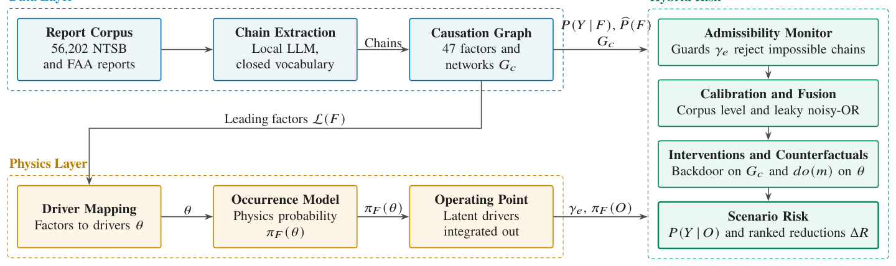

# A Hybrid Framework for Explainable Aviation Risk: Causal Chain Extraction from Safety Reports with Physics-Based Failure Quantification and Interventional Analysis

- arXiv: https://arxiv.org/abs/2610.35658  (v1, submitted 2026-10-26, updated 2026-10-26)
- Authors: Yutian Pang, Yifang Tian, Jiacheng Xie, Xinyu Zhao, Jueming Hu, John-Paul Clarke, Hans-Arno Jacobsen
- Categories: cs.LG
- Collected: 2026-10-28 (KST)

## Abstract

Aviation authorities hold decades of accident reports whose narratives record how investigators reconstructed each accident. Computational work on these archives has mostly sorted reports into fixed taxonomies. In this work, we propose a hybrid framework in which a text-based corpus identifies the leading factors of a failure mode. Physics-based models then quantify how likely that failure is at a stated operating point. Ordered causal chains extracted from 56,202 American accident reports with a local large language model aggregate into a causation knowledge graph. On an evaluation sample of 2,000 reports, the chains recover 90.8% of investigator-flagged causes. Each physical factor whose drivers the record carries receives an occurrence model calibrated to the accident population. A leaky noisy-OR fitted to the corpus combines the factors into a failure mode probability that supports intervention. For engine power loss, the carburetor icing model separates 1,205 icing accidents from other accidents using temperature and dewpoint alone, reaching 0.61 in area under the receiver operating characteristic curve against a density ratio ceiling of 0.64. Routine weather hours give no valid control, because flying concentrates in fair weather. On later years the physics adds 0.03 to that area for occurrence and nothing for severity, so its value lies in interpretability. On four named accidents, abduction gives a probability of necessity of 0.29 to 0.50 for the heat omission, under monotonicity. The Fast Causal Inference algorithm does not license the largest backdoor adjustment on the learned networks.

## Figure 1

Fig. 1. The hybrid framework. The data layer converts 56,202 report narratives into ordered causal chains and aggregates them into a causation graph. The graph gives the leading factors L(F), the consequence conditionals P(Y | F), the corpus base rates bP(F) and the per-category networks Gc. The physics layer maps the leading factors that have physical drivers to continuous variables θ and evaluates an occurrence model πF at the stated operating point. The admissibility monitor rejects any chain whose transitions the guard margins γe rule out at the recorded state. Calibration ties the level of the physical model to the corpus marginal, and a leaky noisy-OR fitted to the corpus combines the contributing factors of a failure mode. Interventional queries act through backdoor adjustment on Gc or through an intervention do(m) that transforms the physical drivers.
