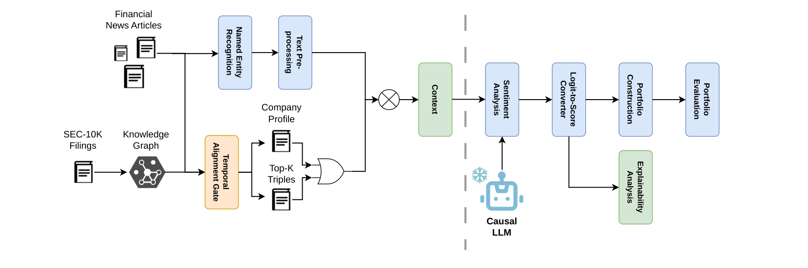

# FinLLM-KG: Knowledge Graph-Enhanced LLMs for Financial Sentiment Analysis in Algorithmic Trading

- arXiv: https://arxiv.org/abs/2610.36083  (v1, submitted 2026-10-26, updated 2026-10-26)
- Authors: Giorgos Iacovides, Oliver Hannibal, Wuyang Zhou, Danilo Mandic
- Categories: cs.CL, cs.LG, q-fin.ST, q-fin.TR
- Collected: 2026-10-29 (KST)

## Abstract

Recent advances in Generative AI have substantially improved financial sentiment analysis through post-trained financial large language models (LLMs). However, existing approaches remain confined to predicting the sentiment of each article in isolation and operate as black boxes, which limits contextual understanding and hinders deployment in high-stakes financial decision-making. To this end, we introduce FinLLM-KG, a model-agnostic framework that combines causal LLMs with a financial knowledge graph, in order to inject temporally grounded, company-level knowledge from SEC 10-K filings at inference time, without updating model weights. Within FinLLM-KG, context is supplied either as a natural-language company profile or as a small set of relevance-ranked factual triples. This enables sentiment predictions to account for broader firm-level information rather than the article alone, at almost zero computational cost and for any causal LLM. In addition, attributing each article-level sentiment score to individual sentences and to the retrieved knowledge-graph facts makes the evidence behind the prediction inspectable, thereby enhancing explainability and supporting human-in-the-loop review. Simulations demonstrate that FinLLM-KG consistently improves portfolio performance over the state-of-the-art baseline.

## Figure 1

Fig. 1. Overview of FinLLM-KG. (a) Financial news articles are tagged and preprocessed. In parallel, fixed-relation 10-K triples from FinReflectKG [8] are restricted by a temporal alignment gate to the latest 10-K filed strictly before the article. Eligible facts are supplied either as a company profile or as the top-k retrieved triples and mixed with the article; in the baseline, the context is the article alone. (b) A frozen causal LLM performs sentiment analysis on the resulting context (prompt). The sentiment signal is used in the portfolio construction framework and, for the proposed methods only, can be decomposed into sentence-level and triple-level attributions for explainability.
