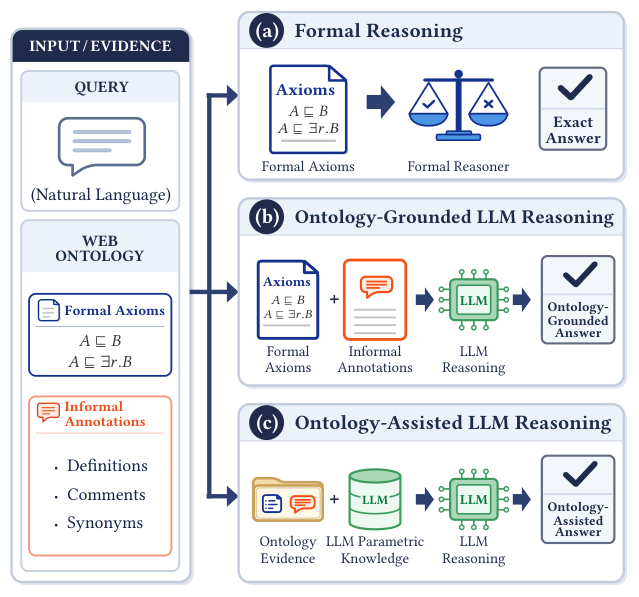

# OA-RAG: Ontology-based Agentic RAG for Faithful LLM Reasoning

- arXiv: https://arxiv.org/abs/2610.36335  (v1, submitted 2026-10-26, updated 2026-10-26)
- Authors: Hui Yang, Jiaoyan Chen, Yongsheng Gao
- Categories: cs.AI
- Collected: 2026-10-29 (KST)

## Abstract

Large language models (LLMs) perform well across many real-world tasks but remain prone to hallucination, limiting their reliability in domains such as biomedicine and healthcare, where answers must be grounded in established knowledge. Retrieval-augmented generation (RAG) mitigates this problem by incorporating external information, but often overlooks logical relationships and relies heavily on the LLM's own reasoning, which can compromise answer faithfulness. We propose OA-RAG, an agent that integrates formal reasoning with LLM reasoning, drawing on both the logical structure and informal annotations of domain ontologies. For each answer, OA-RAG reports the ontology observations used as evidence and a model-assessed grounding level (entailed, supported, related, or unrelated) that characterises the strength of that evidence. Across benchmarks derived from three large-scale ontologies and six real-world medical question-answering tasks, OA-RAG achieves the best overall performance among the evaluated ontology-fine-tuned and popular RAG methods, with particularly strong results on reasoning-intensive tasks. The reported grounding levels also offer a useful indication of answer reliability, with stronger grounding generally associated with higher accuracy. Finally, our results demonstrate the value of ontologies as knowledge sources: OA-RAG is competitive with, and sometimes outperforms, domain-specific RAG systems that draw on sources such as textbooks.

## Figure 1

Figure 1: Three ontology-augmented LLM reasoning patterns, ordered from greatest to least faithfulness to the ontology: (a) the answer is can be inferred from the ontology’s formal axioms; (b) an LLM can infer the answer based on the ontol- ogy’s formal axioms and informal annotations; and (c) an LLM generates the answer freely, with optional grounding in relevant ontology content (classic RAG).
