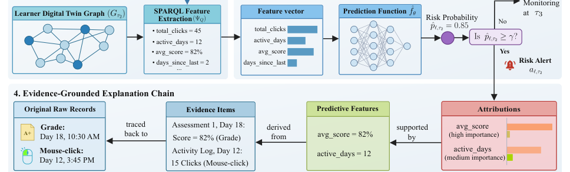

# An Incremental Knowledge-Graph Learner Digital Twin for Evidence-Grounded Early Warning

- arXiv: https://arxiv.org/abs/2610.36820  (v1, submitted 2026-10-27, updated 2026-10-27)
- Authors: Ngoc Luyen Le, Marie-Hélène Abel, Bertrand Laforge
- Categories: cs.AI
- Collected: 2026-10-29 (KST)

## Abstract

Early-warning models in learning analytics can identify learners at risk of failure or withdrawal, but the resulting alerts are often only weakly connected to inspectable learning evidence. A risk score may indicate that intervention is needed without showing which traces, assessment events, or temporal patterns justify the alert. This paper introduces an incremental Learner Digital Twin for evidence-grounded early warning, implemented as a lightweight knowledge graph. The twin is updated at temporal checkpoints by replaying learning traces and assessment records, and it serves both as a feature-extraction substrate and as an explanation-grounding substrate. Predictive features are derived through graph-mediated queries, while features, attributions, alerts, evidence items, and raw records are represented as queryable graph entities. The framework is instantiated and evaluated on a public learning-analytics benchmark under a temporal protocol. The results show that graph-mediated feature extraction preserves the predictive behavior of equivalent raw-table features across model families and checkpoints. Generated alerts are materialized as evidence chains linking risk decisions to feature attributions, evidence items, and raw platform records. The study shows that early-warning prediction can be routed through a semantic and provenance-aware representation while preserving predictive performance and adding traceability, verifiability, and evidence-grounded explanation.

## Figure 1

Fig. 1. Generic workflow of the incremental ldt for evidence-grounded early warning.
