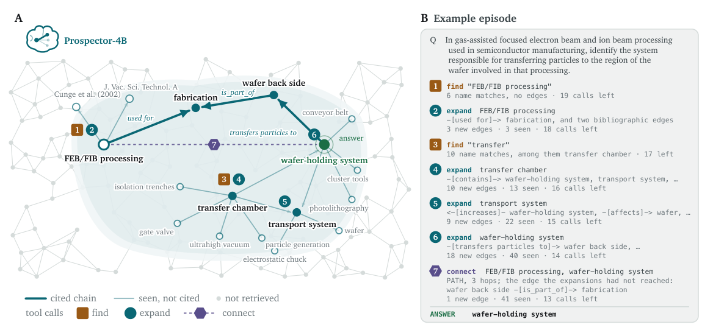

# Prospector: learning a compact graph traversal policy for scientific reasoning

- arXiv: https://arxiv.org/abs/2610.37121  (v1, submitted 2026-10-27, updated 2026-10-27)
- Authors: Haiqian Yang, Markus J. Buehler
- Categories: cs.AI, cond-mat.mtrl-sci, cs.CL, cs.LG
- Collected: 2026-10-29 (KST)

## Abstract

Scientific reasoning in specialized engineering fields depends on knowledge scattered across the literature, often proprietary and absent from frontier LLM training data. In such domains, frontier models tend to give generic answers. Knowledge graphs (KGs) can ground LLM reasoning. Because a graph is too large to provide in full, typical LLM+KG systems preselect a portion, deciding relevance before reasoning begins. Here we train a compact model, Prospector, to reason over a domain knowledge graph by traversing it step by step, seeking evidence in light of what it has already found. Prospector calls a small set of tools one at a time to progressively build its context, and answers with a chain of evidence that can be checked edge by edge against what its tools retrieved from the graph. On a knowledge graph built from the semiconductor-manufacturing literature, Prospector approaches the strongest off-the-shelf models given the same graph and tools, and it far exceeds off-the-shelf models answering closed-book or from a pre-selected portion of the graph. Although trained only on the semiconductor graph, Prospector transfers to unseen knowledge graphs from three other distinct fields: bio-inspired materials, per- and polyfluoroalkyl substances (PFAS) and materials properties. Served on a single GPU, Prospector answers faster and at a fraction of the cost of a hosted service, while keeping proprietary data on the owner's hardware. We find that the policy's latent state is indicative of its next move on both seen and unseen graphs, and modulating the latent state can steer the policy from one behavior mode to another. These results suggest a practical LLM + KG paradigm for scientific and engineering reasoning over private data, in which a compact model trained on a graph from published literature transfers its traversal to unseen graphs that stay with their owners.

## Figure 1

Figure 1. One episode of Prospector on the semiconductor graph. A, the region of the graph the policy retrieved, one tool call at a time, with the chain of edges its answer cites. Gray nodes and edges stand schematically for the part of the graph the episode never retrieved. B, the same episode as tool calls and the observations they returned. A sampled episode of Prospector-4B on a held-out question, reproduced in full in Appendix B.
