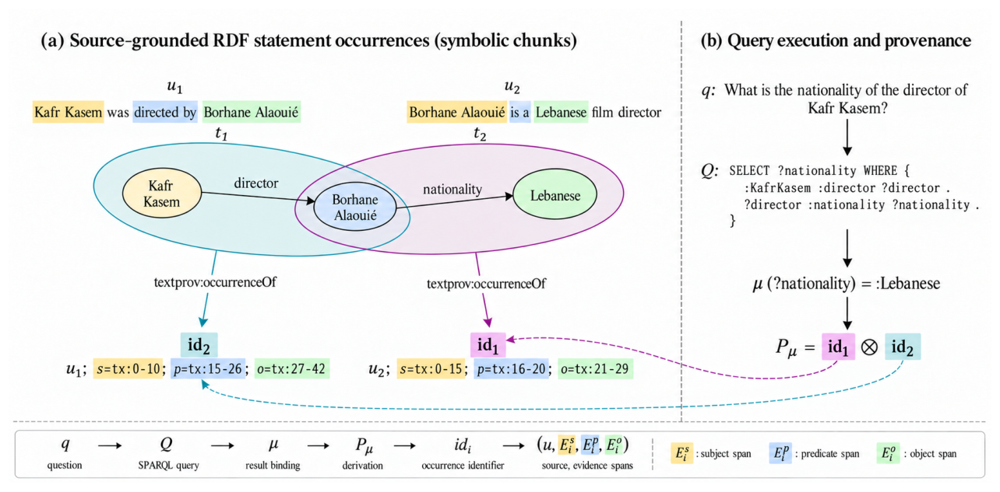

# GraphRAGProv: GraphRAG Meets How-Provenance

- arXiv: https://arxiv.org/abs/2610.37237  (v1, submitted 2026-10-27, updated 2026-10-27)
- Authors: Wadie El Amrani, Luis Galárraga
- Categories: cs.AI, cs.DB
- Collected: 2026-10-29 (KST)

## Abstract

GraphRAG systems often use knowledge graphs to retrieve relevant context for an LLM that produces the final answer. That makes answers more inscrutable and therefore less appealing for domains where transparency is paramount. We present GraphRAGProv, an architecture that executes SPARQL queries over source-grounded RDF graphs to compute answers and their how-provenance polynomials. These polynomials record which statement occurrences were used and how they were combined. Because each occurrence is linked to its source text, users can follow these links to check whether the extracted statements reflect the text and whether the query combines them to answer the question. Querying thereby becomes a way to inspect and evaluate the text-to-graph transformation. Our interactive demo examines 400 cases from two multi-hop QA benchmarks, revealing extraction and query errors even when the final answer is correct.

## Figure 1

Figure 1: (a) Source-grounded RDF statement occurrences constructed from text. (b) SPARQL question answering and provenance tracing from answer bindings to RDF occurrences and exact source text evidence.
