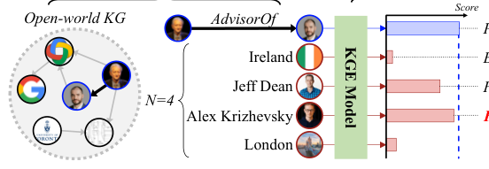

# How Many and How Much? Contrastive Learning with Negative Samples for Knowledge Graph Embedding

- arXiv: https://arxiv.org/abs/2610.37389  (v1, submitted 2026-10-27, updated 2026-10-27)
- Authors: Sooho Moon, Yunyong Ko
- Categories: cs.LG
- Collected: 2026-10-29 (KST)

## Abstract

Knowledge graph embedding (KGE), a fundamental technique for knowledge-centric Web and KG-augmented AI applications, is commonly trained through contrastive learning with negative samples to learn discriminative representations. Despite its empirical success, two crucial questions regarding negative samples remain underexplored: (Q1) how many negative samples should be used for each positive sample and (Q2) how much should each negative sample contribute to learning? To answer these questions, we propose RADAR, a novel contrastive learning framework for KGE models with two effective strategies, respectively: (1) Risk-aware negative budget allocation quantifies false-negative sampling risk by modeling an open-world KG as a stochastic partial observation of its closed-world counterpart and adaptively assigns a negative budget to each positive sample based on its risk; (2) Distribution-calibrated negative weighting assigns negative weights by calibrating the weighting strength for each positive based on two complementary characteristics of the negative-score distribution: dispersion and concentration. Extensive experiments on 3 real-world KGs with 4 KGE models reveal that RADAR achieves the best KGE performance on average across all model--KG combinations and reduces sampled false negatives by over 90% compared with conventional fixed-budget methods.

## Figure 1

Figure 1: Process of contrastive learning with negative sam- ples for knowledge graph embedding.
