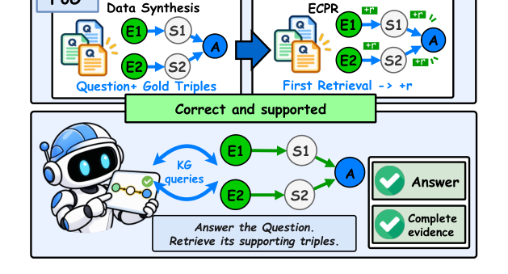

# Clearing the FoG: Training KG Agents to Retrieve the Evidence Behind Their Answers

- arXiv: https://arxiv.org/abs/2610.37405  (v1, submitted 2026-10-27, updated 2026-10-27)
- Authors: Zongyuan Sun, Shuai Zhao, Yingjun Du, Ke Shu, Ziyue Zhu, Haoran Luo
- Categories: cs.AI
- Collected: 2026-10-29 (KST)

## Abstract

Large language models (LLMs) can answer many factual questions correctly, but a correct answer is not necessarily a supported one. For an LLM agent, a knowledge graph (KG) plays two roles: as a source of answers, it supplies facts that the model lacks; as a source of evidence, it supplies the supporting triples that make an answer traceable and auditable. However, existing KG agents treat the KG only as a source of answers: their training data carries answers but not evidence, and their training rewards check the answer but not the retrieved evidence, so agents often answer correctly without retrieving the supporting triples. We propose FoG, a framework that trains KG agents to retrieve the evidence behind their answers. FoG consists of evidence-grounded synthesis, a KG interaction agent, and an evidence-coverage process reward (ECPR): the synthesis recursively hides explicit entities behind verifiable sub-questions, so that every question carries its supporting triples by construction; the agent records the triples returned by the KG; and ECPR credits each supporting triple to the turn that first retrieves it. Experiments on three KGQA benchmarks demonstrate that FoG enables 3B--4B open-source agents to outperform substantially larger baselines in answer accuracy and evidence coverage, with zero-shot cross-KG transfer.

## Figure 1

Figure 1: Motivation of FoG. Answer-only training yields correct but unsupported answers, whereas FoG embeds supporting triples at synthesis and rewards their retrieval during RL training.
