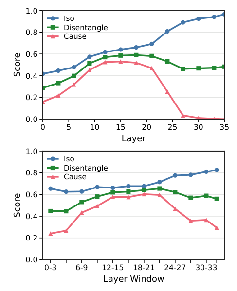

# Can LLMs Faithfully Solve Ontology Engineering Tasks? A Mechanistic Interpretability Study

- arXiv: https://arxiv.org/abs/2610.38326  (v1, submitted 2026-10-28, updated 2026-10-28)
- Authors: Bohui Zhang, Albert Meroño-Peñuela, Elena Simperl
- Categories: cs.AI
- Collected: 2026-11-02 (KST)

## Abstract

Ontological knowledge underpins large language model (LLM) performance on knowledge-intensive tasks. However, existing evaluations of LLMs' ontological understanding largely rely on behavioral correctness, leaving the underlying mechanisms unexplained. Existing mechanistic interpretability work has largely focused on instance-level factual knowledge, leaving ontological knowledge under-explored. To bridge this gap, we introduce MIOE, a causal-abstraction benchmark that evaluates interchange interventions for two ontology engineering tasks: entity typing and subsumption prediction. MIOE tests whether learned internal intervention targets can change an ontology-level target answer while preserving class-specific auxiliary information. Across Qwen3-8B and Qwen3-4B, we evaluate SAE-, DBM-, and DAS-based methods, including multi-task and multi-layer variants. Distributed subspace methods give the strongest results and generalize across prompt settings, but the induced changes remain only partially separated from auxiliary class-specific information. Multi-task objectives and contiguous layer-window interventions improve this balance, while class-level analyses reveal substantial variation across ontology classes. These results suggest that ontological predictions are mechanistically accessible in LLMs, although current methods do not yet isolate a cleanly disentangled causal mechanism for ontological knowledge.

## Figure 1

Figure 1: Representative layer profiles for Qwen3-8B on instance of. The top panel shows single-layer MDAS with rank 2048, and the bottom panel shows four-layer MDAS with 256 × 4 contiguous windows. Both panels report Cause, Iso, and Disentangle.
