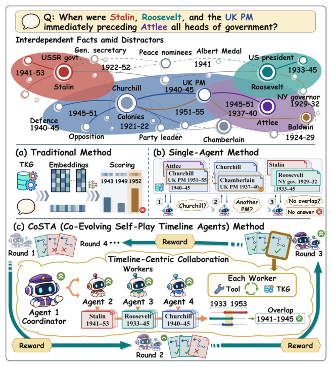

# CoSTA: Co-Evolving Self-Play Timeline Agents for Complex Temporal Knowledge Graph Question Answering

- arXiv: https://arxiv.org/abs/2610.38450  (v1, submitted 2026-10-28, updated 2026-10-28)
- Authors: Haikun Liu, Zhichao Yan, Shaoru Guo, Jiawei Gu, Victor Gutierrez Basulto, Jiapu Wang, Ru Li
- Categories: cs.CL
- Collected: 2026-11-02 (KST)

## Abstract

Complex Temporal Knowledge Graph Question Answering (TKGQA) involves more than retrieving facts: the timestamp or validity interval of one fact can constrain the search for another, while multiple intervals may jointly determine the answer. Existing single-agent TKGQA methods typically investigate these facts within a single reasoning context, where evidence from different event histories can become interleaved and distractors can misdirect subsequent retrieval. Distributing investigations across agents can separate event-specific evidence into distinct contexts, but effective collaboration must still be learned because question decomposition, subtask investigation, and evidence synthesis are interdependent. To address these limitations, we propose \textbf{Co}-Evolving \textbf{S}elf-Play \textbf{T}imeline \textbf{A}gents (CoSTA), which organizes facts into navigable timelines, delegates investigations to workers, and uses a coordinator to synthesize their original timestamped observations. CoSTA initializes a shared policy through role-conditioned distillation and jointly optimizes both roles through co-evolving self-play with final-answer rewards. Across three benchmarks, CoSTA achieves state-of-the-art overall performance, with particularly strong gains on complex multi-fact questions, while its compact variants outperform the evaluated closed-source LLM agents.

## Figure 1

Figure 1: Motivating comparison of (a) Traditional TKGQA, (b) Single-agent TKGQA, and (c) Our proposed CoSTA, which coordinates separate timeline investigations and co-evolves the coordinator and workers through self-play.
