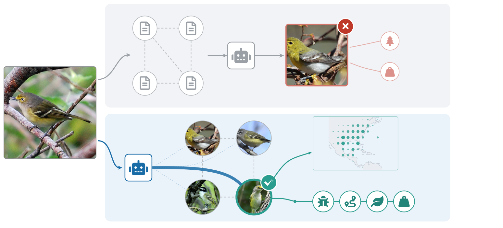

# FieldGuideRAG: Image-Grounded GraphRAG for Fine-Grained Recognition with Vision-Language Models

- arXiv: https://arxiv.org/abs/2610.40971  (v1, submitted 2026-10-29, updated 2026-10-29)
- Authors: Jiacheng Ding, Yanliang Qi, Cong Guo, Peihua Mai
- Categories: cs.CV, cs.IR
- Collected: 2026-11-03 (KST)

## Abstract

We present FieldGuideRAG, a training-free GraphRAG method in which a vision-language model, or VLM, recognizes fine-grained species by comparing the query with real photographs stored on the nodes of a knowledge graph. Multimodal GraphRAG systems describe each entity in text, and text conveys little of the visual detail that separates look-alike species. Our graph stores one photograph on every species node and links each species to its relatives, its geographic range and its ecological facts. A frozen VLM verifies the query against the photograph of each candidate node. FieldGuideRAG fuses the verification scores with the range edge and answers questions about the organism from the fact edges of the verified species. On CUB-200, a Wikidata graph and four iNaturalist domains, the node photograph improves verification over the species name on every graph, while text descriptions add little. Verification of the candidate pool exceeds a SigLIP retriever by up to 16 points, the range edge adds 7 to 19 points on iNaturalist, and answering from fact edges is correct on up to 89.5% of 28,820 ecological questions. The verification scores also detect queries whose species is missing from the graph. Graphs, prompts and code will be released.

## Figure 1

Figure 1. FieldGuideRAG. A GraphRAG with text nodes leads Qwen3-VL-8B to a look-alike and to the facts of that look-alike in the upper row, and our image-grounded graph lets the VLM verify the query against each node photograph and follow the range and fact edges of the verified species in the lower row.
