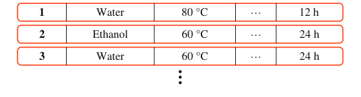

# RAHC: Rule-Augmented Hyper-Relational Knowledge Graph Completion for Materials Synthesis

- arXiv: https://arxiv.org/abs/2611.04809  (v1, submitted 2026-11-03, updated 2026-11-03)
- Authors: Jiawei Sun, Sijia Xu, Zihan Chen, Zhengyi Yang
- Categories: cs.AI
- Collected: 2026-11-05 (KST)

## Abstract

Scientific discovery depends on reusing experimental knowledge, yet records scattered across papers and repositories are often incomplete. In materials synthesis, recovering missing conditions requires reasoning about the target material and the observed context of a specific experiment. Hyper-relational knowledge graphs (HKGs) represent this context through qualifiers, but existing completion methods leave domain knowledge and experimental regularities implicit. We propose RAHC, a rule-augmented HKG framework for single-slot and joint multi-slot synthesis-condition completion. RAHC builds a traceable rule catalog from training records and retrieved literature, retrieves rules for each query-candidate pair, and separately encodes graph structure and rule evidence. Hard rules constrain candidate validity, while soft rules guide ranking. RAHC-G aggregates rules using global reliability; RAHC-Q additionally learns query-specific relevance. Gated fusion combines structural and rule representations, while tuple-conclusion rules provide cross-condition evidence for joint completion. Experiments on five materials-synthesis datasets show improvements in single-slot and joint completion under Semi-inductive and Open-Answer Inductive settings, with Semi-inductive MRR gains of up to 15.6% over MAYPL. RAHC also improves performance on the entity-disjoint ILPC'22 Small benchmark, supporting transfer to fully inductive KG completion. These results support experimental condition selection, synthesis planning, and the reuse of scientific knowledge.

## Figure 1

Figure 1: Joint completion of 𝑛masked conditions. Candidate values and ranking are illustrative.
