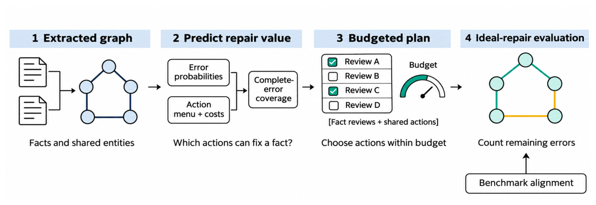

# When Does Better Confidence Improve a Knowledge-Graph Audit?

- arXiv: https://arxiv.org/abs/2611.05877  (v1, submitted 2026-11-04, updated 2026-11-04)
- Authors: Zehao Lin, Kai Chen, Xixuan Hao, Erenkai Zhu, Chunyu Li, Helan Hu
- Categories: cs.CL
- Collected: 2026-11-06 (KST)

## Abstract

Confidence estimates guide human review in LLM-built knowledge graphs, but better error prediction can yield little improvement in an audit. We study this gap through repairability, selection headroom and label validity. Modelling non-adaptive auditing as budgeted covering, we characterise the minimal decision-relevant error statistics and bound the regret of scalar-preserving first-order planning by a structural mass $Δ^{\mathrm{cl}}$. We simulate ideal repair against benchmark-aligned labels for five extraction configurations and two cross-document graphs on Re-DocRED, followed by frozen confirmation on test and replication on 500 hash-selected training documents. On the held-out cross-document graphs, an error-rate $\times$ fan-out queue leaves 3.98-4.74 percentage points more errors than a joint model with the same actions. By comparison, opening shared actions for that joint planner reduces residual errors by 0.89-1.43 points relative to its own fact-only plans, in point estimates. Equivalence between joint and independent-block models remains inconclusive. Generic LLM verification improves three of four model-budget configurations on each held-out set. LLM adjudication identifies possible benchmark omissions.

## Figure 1

Figure 1: The audit evaluation pipeline. Error predictions and a fixed action menu determine a plan under the review budget. Evaluation simulates ideal repair against benchmark-aligned labels: fact i is correct after review exactly when the chosen actions cover its complete error set, Ei ⊆τi(P).
