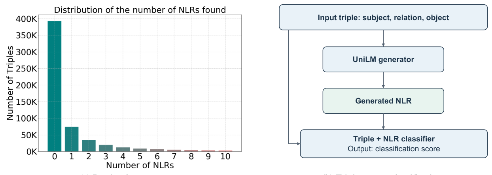

# Bridging Structure and Semantics: Knowledge Graph Verification via Triple-to-Text Alignment

- arXiv: https://arxiv.org/abs/2611.07780  (v1, submitted 2026-11-05, updated 2026-11-05)
- Authors: Ziang Cui
- Categories: cs.CL, cs.AI
- Collected: 2026-11-09 (KST)

## Abstract

Semantic accuracy is an important dimension of knowledge graph quality. Graph-based scoring methods exploit relational structure, while textual representations allow classifiers to draw on knowledge encoded by pre-trained language models (PLMs). We present GenVer, a generative verifier that scores triples using both their serialized form and generated natural language representations (NLRs). A triple-text alignment procedure selects training pairs for a sequence-to-sequence generator; a BERT-based classifier then combines features from each triple and its generated NLR. On four FactFB variants, constructed from FB15k using perturbed negative triples, GenVer obtains the highest classification accuracy among the evaluated baselines, ranging from 88.56% to 91.52%. The experiments suggest that generated representations can help triple classification, while the case analysis also exposes semantic drift and high-confidence errors.

## Figure 1

Figure 1: (a) Number of candidate NLRs retrieved per FB15k triple under the restricted search procedure. (b) GenVer uses generated text as a feature for triple classification.
