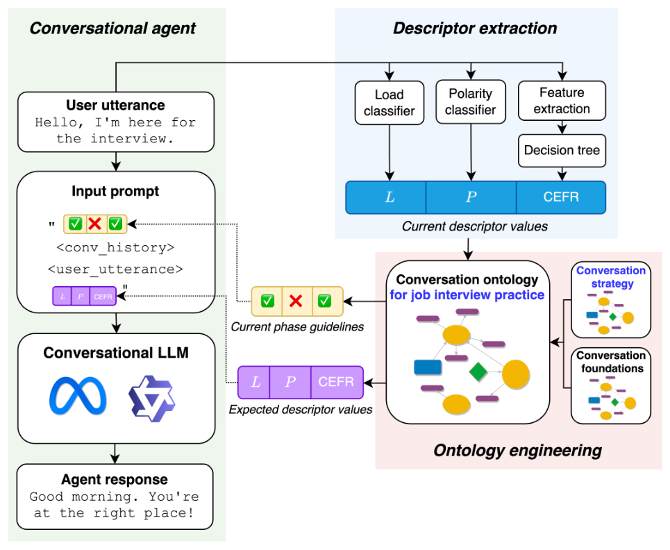

# Ontology-Driven Control of Conversational Agents with a Use-Case for Job Interview Practice

- arXiv: https://arxiv.org/abs/2611.09282  (v1, submitted 2026-11-06, updated 2026-11-06)
- Authors: Barbara Gendron, Gaël Guibon, Mathieu D'aquin
- Categories: cs.AI
- Collected: 2026-11-10 (KST)

## Abstract

Large Language Models (LLMs) have been widely used as conversational agents in both domain-specific and open-domain situations. In domain-specific context, it is often necessary to adapt those LLMs to obtain conversations with desired characteristics, whether those apply at the level of each response (e.g. for tone or style) or more globally (i.e. at the level of a conversational strategy). Such adaptations are, however, generally realized in an ad hoc way, through specific, non-reusable, and non-transparent developments. In this paper, we propose an ontology-based approach to design conversational strategies that rely on the desired and measured characteristics of textual utterances in the conversation. Through a use case related to job interview practice, we show how this approach can be used to control LLMs to follow the strategy defined in the ontology. To this end, we automatically fine-tune the LLM to improve its compliance with ontologically-defined conversation characteristics. Our results show that training the LLM from formally defined concepts effectively enhances alignment with the requested characteristics. Hence, this work demonstrates how ontology-guided conversation control can be achieved while taking into account multiple, concurrent conversation aspects that are formally and transparently defined.

## Figure 1

Fig. 1. A detailed overview of our system: we propose a knowledge-enhanced conversational agent, built on an LLM, that interacts with our own ontology to receive generation guidelines. These guidelines are conditioned on descriptor values extracted
