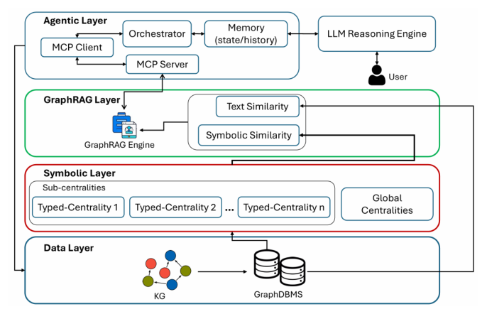

# Typed-Centrality Grounding for Agentic GraphRAG: A Symbolic Approach for Agentic Reasoning

- arXiv: https://arxiv.org/abs/2611.09414  (v1, submitted 2026-11-06, updated 2026-11-06)
- Authors: Rosario Napoli, Antonio Celesti, Massimo Villari, Maria Fazio
- Categories: cs.AI
- Collected: 2026-11-10 (KST)

## Abstract

Knowledge Graphs (KGs) and Large Language Models (LLMs) represent two approaches for knowledge representation and reasoning over heterogeneous data. Recent research has explored their integration through Graph Retrieval-Augmented Generation (GraphRAG) systems, which use KGs to provide structured context to LLMs. However, existing GraphRAG approaches treat KGs as homogeneous graphs and rely on textual similarity between the input prompt and the context, rather than using it as a source of deterministic knowledge. This work proposes an agent-based GraphRAG system that introduces a symbolic layer to integrate deterministic reasoning alongside text similarities. This approach is based on the definition of typed centralities for KGs, where centrality measures are computed separately for each specific KG's class. This information is used to construct a symbolic representation that is provided to the LLM as a deterministic source. The proposed system was mathematically validated and evaluated on a real-world POLE (Person, Object, Location, Event) dataset, comparing reasoning and information retrieval with and without the symbolic layer. The results indicate that the our approach leads to responses that are more consistent with the context, improving the generated outputs.

## Figure 1

Fig. 1. Layered architecture of the Typed-Centrality Grounding framework.
