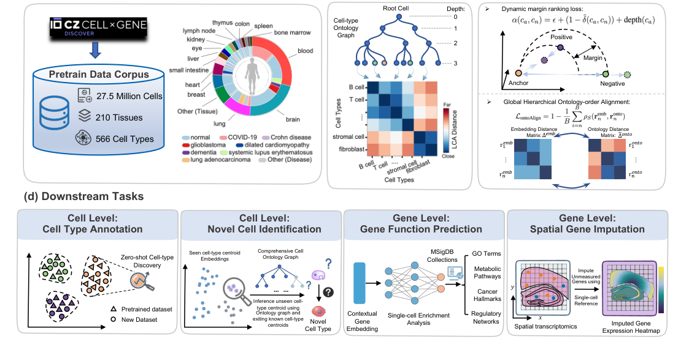

# Learning Biological Hierarchies in Single-Cell Foundation Models

- arXiv: https://arxiv.org/abs/2611.10838  (v1, submitted 2026-11-07, updated 2026-11-07)
- Authors: Xiangyu Guo, Ricardo Henao
- Categories: cs.LG, cs.AI, q-bio.QM
- Collected: 2026-11-10 (KST)

## Abstract

Cell types are organized by taxonomic relationships that define lineages in the so-called cell ontology. However, most existing foundation models typically ignore cell-type lineages encoded in this cell ontology. We introduce a biologically informed foundation model called scOntoFM, which embeds hierarchical cell ontology into representation learning. Using Lowest Common Ancestor (LCA) distances from the ontology graph, our framework pairs efficient offline triplet sampling with hierarchical cell-ontology learning. This approach jointly preserves local neighborhoods and shapes the global embedding geometry to reflect the ontology structure. Across diverse cell- and gene-level benchmarks, the model consistently improves performance, with especially strong gains in zero-shot settings. Our model also balances batch integration with biological structure preservation, providing complementary perspectives to existing embedding evaluation frameworks and supporting scalable biological discovery.

## Figure 1

Figure 1: Proposed model workflow. (a) scOntoFM pre-training data corpus details (left), and the distribution of major tissues and diseases in the corpus (right). (b) An illustration of cell ontology graph and its derived LCA distance matrix. (c) Ontology-aware loss terms in scOntoFM, the dynamic margin α(ca, cn) is controlled by the distance between the anchor cell-type ca and negative cell-type cn, and the depth of the anchor ca in the ontology graph. Down below is the hierarchical ontology alignment loss, in which ∆emb and ˜∆onto ∈RB×B represent correspondingly the distance matrix of our model embeddings and its corresponding LCA distance matrix in the batch (of size B), and where remb
