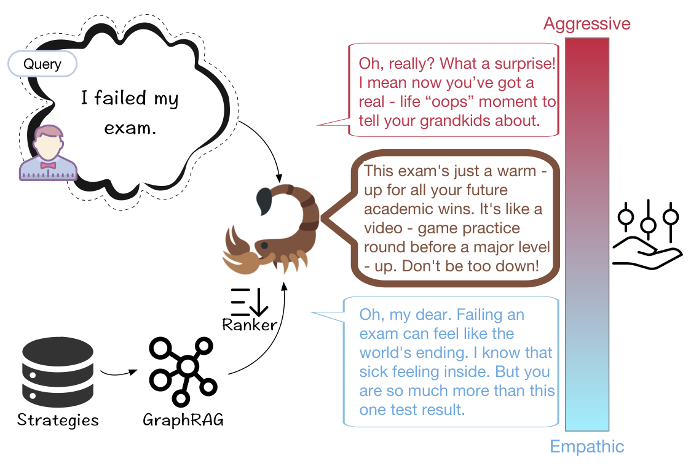

# SCorPion: A Strategic, Controllable and Personified Conversational Companion

- arXiv: https://arxiv.org/abs/2611.10906  (v1, submitted 2026-11-07, updated 2026-11-07)
- Authors: Luo Ji, Xiyuan Chen, Dan Wang, Qingqing Gu, Teng Chen, Feixiang Guo, Yetao Wu, Jinxian Qu, Yue Zhao, Kun Fan, Ningyuan Xi, Hange Zhou, Zhonglin Jiang, Yong Chen, Hongyan Li
- Categories: cs.CL
- Collected: 2026-11-10 (KST)

## Abstract

Fixed prompt-based language models face challenges in open-domain conversations, where versatile topics require different expert advice or demonstrations to maximize their universal performance. Motivated by the dynamic prompt studies in language generation, we extract different chatting strategies from varied forms of text corpus, which steer the language model to different styles based on human principles. We design and deploy a conversational companion called SCorPion, which uses GraphRAG to extract and summarize the knowledge graph globally, yield community-summarized strategies, and produce query-focused optimal strategies. SCorPion has strategic thinking, yields personified and stylized responses, and can be controlled by explicit factors. Code and further results can be found in https://bachozean.github.io/scorpion-page/.

## Figure 1

Figure 1: The paradigm of SCorPion. SCorPion retrieves and ranks the chatting strategy from different textual corpus by GraphRAG, and produces an anthropomorphic response. The ranker can be controlled by outer factors to produce different response styles.
